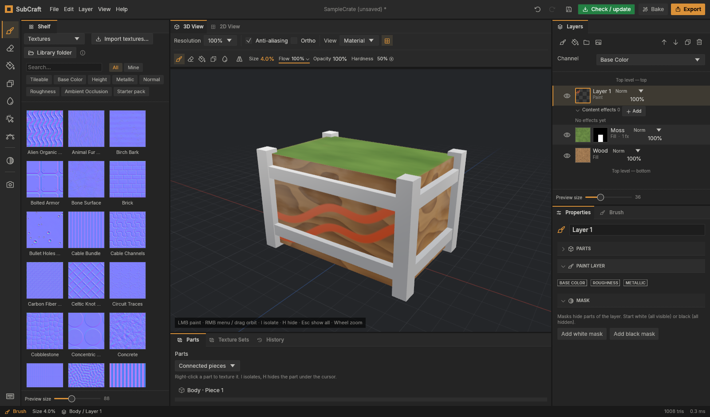
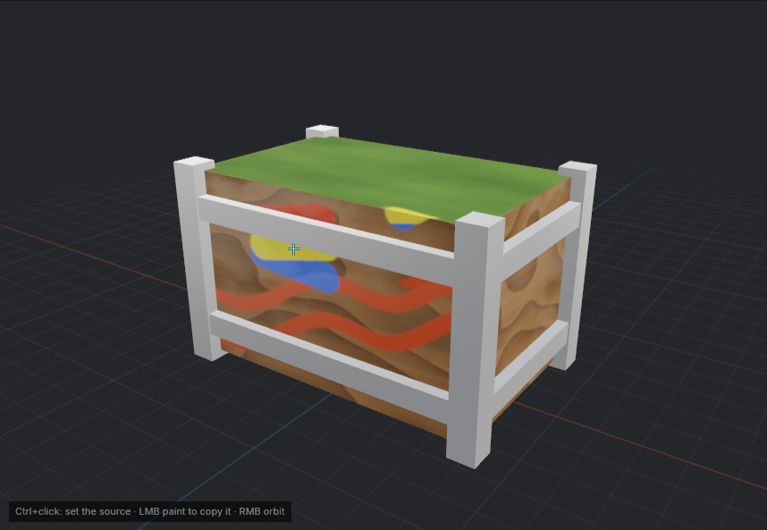
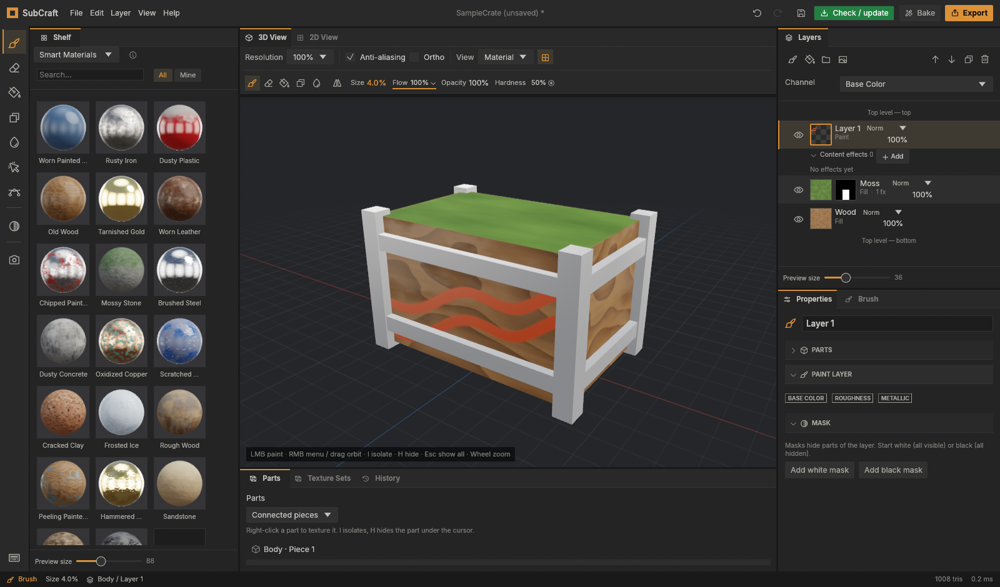
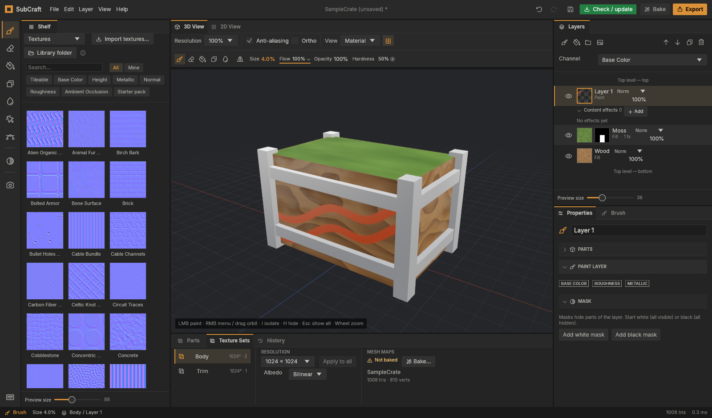
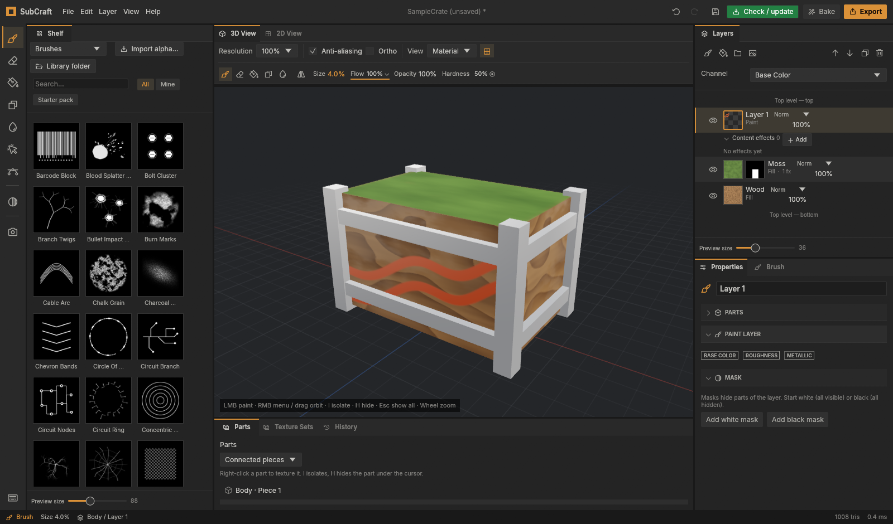
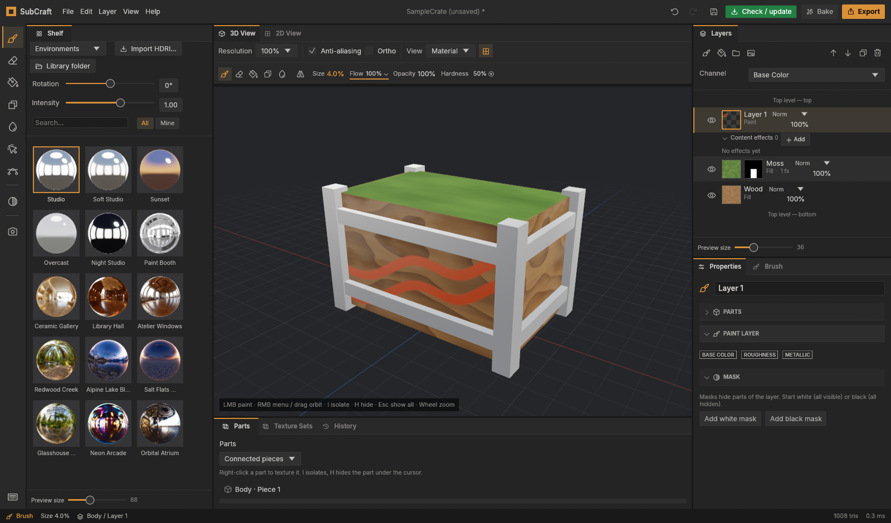
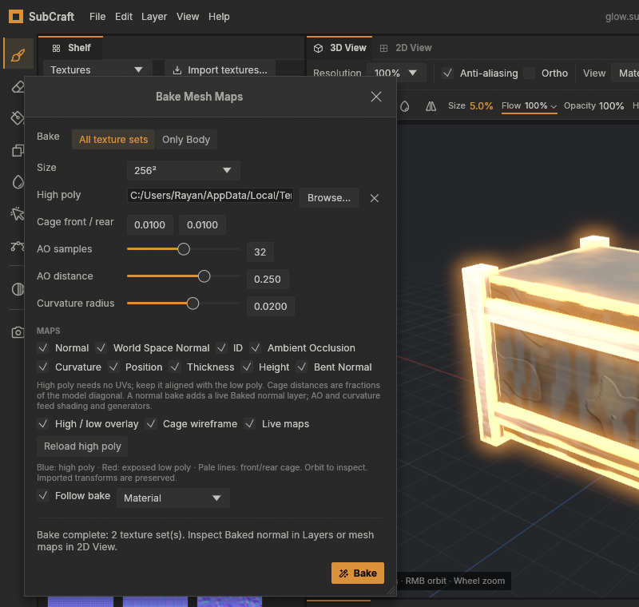
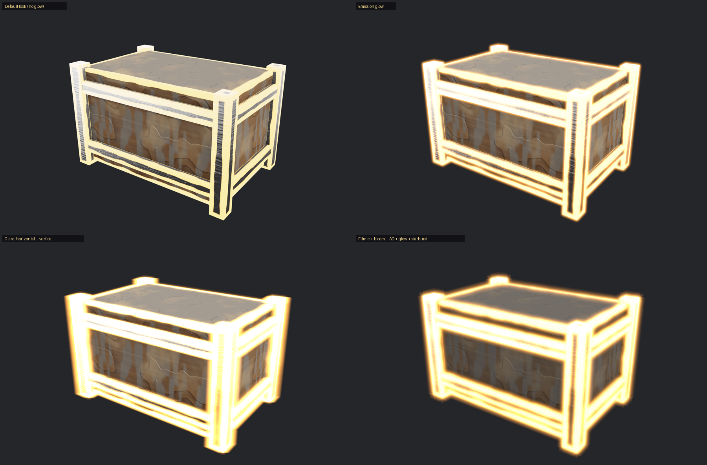
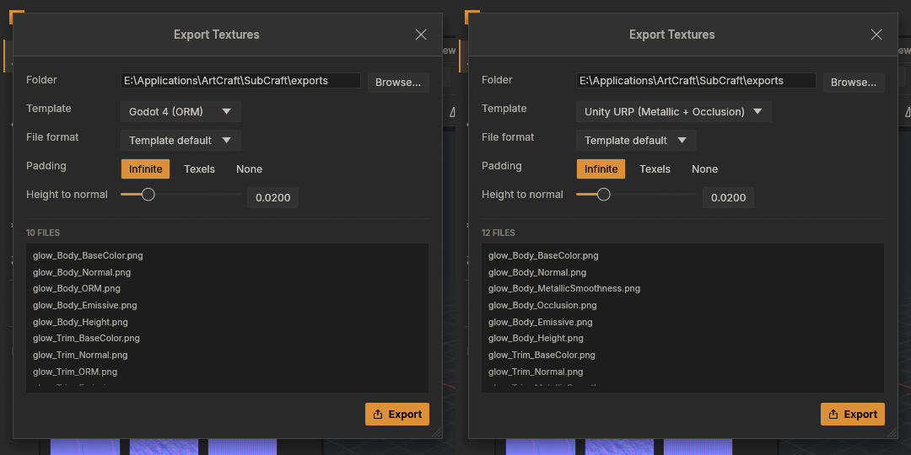

# SubCraft

[](https://github.com/Aalzard/subcraft/releases/latest)
[](https://github.com/Aalzard/subcraft/releases/latest)
[](https://github.com/Aalzard/subcraft/releases/latest)

An independent, open-source 3D texture painting application in the spirit of Substance Painter,
written in Rust. Paint directly on 3D models with layered PBR materials, masks, generators and
smart materials, bake mesh maps, and export game-ready textures. Desktop app for Windows and Linux.

**SubCraft is an independent project. It is not officially developed by, affiliated with,
or endorsed by ArtCraft.**



> **Status: early but usable.** The core engine, painting, baking, smart materials, save/load and
> export all work and are covered by tests. Expect rough edges, missing features and breaking
> changes to the project file format. See [`docs/progress.md`](docs/progress.md) for what is done
> and what comes next.

New here? Follow the [illustrated getting-started guide](docs/getting-started.md). A welcome
screen and a six-step in-app guide are included.

## What's new in 0.1.8

- **Clone and Smudge** tools, plus camera projection for brush images.
- **New Project window**: inspect a model (triangles, materials, objects, UDIM tiles, warnings)
  and choose template, resolution, texture-set split, UDIM, normal format and high poly first.
- **UDIM** tiles become one texture set each; export with `.1001` names or per-tile folders.
- **Export checkboxes** for every map, Select all / None / Invert, Alt+click to export one map.
- **Engine presets** for Unity URP and Godot 4; **Height** and **Bent Normal** bakes.
- **Render quality**: tone mapping, bloom, ambient occlusion, emission glow and glare; render
  stills and PNG turntable frames.
- **15 new smart materials and 16 new smart masks**, five new generators.
- **80 normal maps + 80 brush alphas** (CC0) and **10 built-in HDRI environments**.

Full list: [CHANGELOG.md](CHANGELOG.md).

## Features

### Painting tools



*Clone: Ctrl+click sets the source, later strokes keep the offset.*

- **Brush and eraser** on the 3D model with tips (alphas), symmetry (with red plane guides),
  lazy mouse, jitter, flow/opacity/hardness and **presets** you can save.
- **Clone** (Ctrl+click source) and **Smudge** (carry paint along, Flow is the strength) on paint
  layers and masks. Clone copies from a point; there is no heal or seam blending.
- **Project from the view**: a brush image can be cast from the camera at the start of a stroke
  (once per stroke, not per stamp).
- **Stencils**: paint through an image laid over the view; polygon fill (triangle, mesh part, UV island).
- **Pen paths**: press **P**, click anchors and drag for Bezier handles in 3D or 2D; paths stay editable.


*Editable pen paths with UV width, hardness and opacity.*

### Layers and masks


*Layers with folders, drag-and-drop, inline rename (F2) and top-level drop targets.*

- **Layer stack**: paint layers, fill layers (uniform, procedural, image and mesh-map sources)
  and folders, 32 blend modes, opacity per channel. Drag rows to reorder; folder drop zones and
  rename are adapted from [CalangoTech's SubCraft Studio fork](https://github.com/CalangoTech/subcraft).
- **Masks** with stacked effects: Edges, Cavity, Directional, Position gradient, noise,
  images, Levels, Invert.
- **Generators**: Edges, Cavity, noise fills and the new Dirt, Cracks, Streaks, Speckles and Pores.
- **Filters** on content, masks and folders: Blur, Sharpen, Directional Blur, Highpass, Bevel,
  Mask Outline, Contrast, HSL, Threshold, Clamp, Levels. Drag effects to reorder; effect rows show
  live stage thumbnails.
- **Parts workflow**: right-click the piece under the cursor to fill it, paint only there or
  mask by it; connected pieces, UV islands, imported objects or material IDs; **I** isolates,
  **H** hides, **Esc** restores.
- **Emission** can be added from Properties (+ emiss chip), starting white at intensity 3.
- **Eyedropper** (Shift+click picks all channels), adapted from the CalangoTech fork.

### Materials and Shelf



*Smart materials: 20 in the Shelf, with 21 smart masks.*

- **Smart materials and masks**: 20 smart materials (15 new in 0.1.8) and 21 smart masks (16 new).
  Edge and cavity layers need baked Curvature / AO.
- **Your own textures**: any image (PNG, JPG, TGA, TIF, EXR...) in a fill layer with UV,
  tri-planar or planar projection, or import a whole texture set (matched by file name, glossiness and
  DirectX normals converted). Images are stored in the project.
- **Your library** in `Documents\SubCraft\Library`: imported tips and HDRIs, saved smart materials,
  smart masks and brush presets come back every time you start SubCraft.



*Textures: 80 CC0 starter normals (Textures > Starter pack); click one to preview tiles and adjust it.*



*Brushes: 80 CC0 starter alphas. See the [CC0 credits](assets/starter-pack/CREDITS-CC0.txt).*



*Environments: five studio/sky presets and 10 bundled HDRIs (AI-generated, CC0; HDR lighting is synthesized, not measured). Import your own HDRI too.*

The 2048 x 1024 originals of the 10 HDRIs are an optional download
(`SubCraft-extra-environments.zip`) on the release page: unzip into
`Documents\SubCraft\Library\environments` or use Shelf > Environments > Import HDRI.

### Baking



*Bake window with the new Height and Bent Normal maps.*

- Normal (from an optional high poly through a cage), world-space normal, AO, curvature,
  thickness, position, ID, **Height** and **Bent Normal**, on the CPU in the background.
- Live bake maps appear on the model while the rest compute; high-poly and cage inspection before baking.

### Viewport and rendering



*Emission glow and glare streaks in the viewport.*

- Real-time PBR viewport with studio or HDRI lighting and a 2D UV view of every channel and baked map.
- **Render quality**: tone mapping (ACES, Filmic, Reinhard, Linear), exposure, bloom, ambient
  occlusion, emission glow and glare. These are display-only; exported textures are never affected.
- **File > Render image** (1024-4096 px, optional 2x supersampling) and **Turntable** (24-120
  numbered PNG frames). There is no GIF or MP4 encoder.
- GPU mipmaps keep distant PBR textures from shimmering. Graphics API choice (Automatic,
  DirectX 12, OpenGL) in Edit > Preferences > Graphics.

### Projects


*New Project: model summary with warnings, template, resolution, split rule, UDIM and normal format.*

- **New Project window** (File menu or Welcome screen): see triangles, materials, objects, UV
  range, UDIM tiles and warnings, then choose template, resolution, texture-set split
  (by material / by object / one set), UDIM, normal format and an optional high-poly model.
- **UDIM**: each tile is its own texture set with its own layers. Limits: no 2D tile picker and
  no apply-to-all-tiles command yet.
- **Autosave and crash recovery**: a recovery copy is written in the background to SubCraft's data
  folder, never over your own file; after a crash SubCraft offers to restore it.
- **Updates**: the green Check / update button downloads, verifies and installs the latest stable
  release and restarts with your unsaved project restored.
- **Bug reports**: Help > Report a bug opens a GitHub issue with version, OS and GPU filled in.
- Mesh import: OBJ, glTF / GLB and FBX. Project files are `.subcraft`.

### Export


*Export: every map listed per texture set with checkboxes and a live file count.*

- Templates: PBR metal/rough, Unreal (ORM packed), Unity HDRP (mask map), **Unity URP**,
  **Godot 4** and glTF.
- Per-map **checkboxes** with Select all / None / Invert; **Alt+click** a map to export only it
  (Alt+click again restores your selection). The selection is saved with the project.
- The project's normal-map convention (OpenGL / DirectX) applies to exported normals.
- UDIM export as `Name_Body_BaseColor.1001.png` or one folder per tile.



*Engine presets such as Godot 4 and Unity URP.*

## System requirements

- **Windows** 10 or 11, 64-bit, with a GPU that supports DirectX 12 (Vulkan also works).
- **Linux** x86_64 (built on Ubuntu 22.04, runs on that and newer), a Vulkan driver (Mesa or
  your GPU vendor's) and X11 or Wayland.
- Memory use grows with texture resolution and layer count; no minimum has been measured.

## Getting started

Open a model with **File > New project from a model** (or the Welcome screen): the New Project window
shows what is in the model and lets you pick template, resolution and options before creating it.
Then bake mesh maps, drag a smart material or paint, and export. The
[illustrated getting-started guide](docs/getting-started.md) walks through each step. To try SubCraft
without a model, use the sample crate that opens by default, or start it with `--demo`.

## Download and install

### Windows

1. Open the [latest release](https://github.com/Aalzard/subcraft/releases/latest) and download
   **`SubCraft-<version>-setup.exe`** under **Assets**.
2. Run it. Windows SmartScreen may say "Windows protected your PC" because the installer isn't
   code-signed yet: click **More info → Run anyway**.
3. Follow the steps (you can choose "Install for me only" if you don't have admin rights), then
   start SubCraft from the Start Menu. Uninstall it any time from **Settings → Apps**.

Prefer no installer? Download **`SubCraft-<version>-windows-x64.zip`** instead, unzip it and run
`SubCraft.exe`. Either way, any GPU with DirectX 12 works (SubCraft uses Direct3D 12 on Windows; to
try Vulkan instead, set the environment variable `WGPU_BACKEND=vulkan`).

The installer replaces an earlier installed version. Once you have a build with the green
**Check / update** button (v0.1.4 or newer), click it to install future stable releases and
restart with your project restored. Wait until release packages finish uploading if the app
says they are still being prepared.

### Linux

1. Download **`SubCraft-<version>-linux-x86_64.tar.gz`** from the
   [latest release](https://github.com/Aalzard/subcraft/releases/latest) and unpack it:
   `tar -xzf SubCraft-*-linux-x86_64.tar.gz`
2. Run `./install.sh` inside the folder to add SubCraft to your application menu (installs to
   `~/.local`, no root needed; `./install.sh --uninstall` removes it), or just start `./subcraft`.

Needs a Vulkan driver (Mesa or your GPU vendor's) and X11 or Wayland. Built on Ubuntu 22.04, so it
runs on that and newer distributions.

## Building from source

You need a recent stable [Rust toolchain](https://rustup.rs) (1.95 or newer) and a GPU with
Vulkan, Metal or DirectX 12 support.

```sh
git clone https://github.com/Aalzard/subcraft.git
cd subcraft
cargo run --release
```

The app opens with a sample crate. Try `cargo run --release -- --demo` for a ready-made layer
stack, or pass a mesh / project file: `cargo run --release -- path/to/model.fbx`.

Step-by-step Windows setup, the daily workflow and building the `.exe` yourself:
[`docs/development.md`](docs/development.md).

On Linux you may need the usual windowing libraries (for example on Debian / Ubuntu:
`libxkbcommon-x11-0 libegl1`) and a Vulkan driver.

### Controls

| Action | Input |
| --- | --- |
| Paint / erase | Left mouse (B = brush, E = eraser) |
| Straight line | Shift + click |
| Orbit | Alt + left mouse, or right mouse |
| Part actions | Right click without dragging |
| Isolate / hide hovered part | `I` / `H` in the 3D view |
| Show all parts | `Esc` in the 3D view, or Parts → Show all parts |
| Pan | Middle mouse |
| Zoom | Mouse wheel, or Alt + right mouse |
| Brush size | `[` and `]` |
| Move / rotate / scale stencil | Hold S + middle / left / right mouse |
| Paint without the stencil | Hold N |
| Apply a shelf item | Click it, or drag it onto the model or a layer |
| Bake mesh maps | Ctrl + B |
| Export textures | Ctrl + Shift + E |
| Undo / redo | Ctrl + Z / Ctrl + Y |

Help → Keyboard shortcuts lists all of them.


## Project layout

SubCraft is a Cargo workspace of small crates with a strict dependency direction (lower crates
never depend on higher ones, and only the rendering and UI crates know about the GPU or egui):

```
core ← image ← mesh / doc ← materials ← compositor / paint / bake ← project / export / assets ← app ← ui ← apps
```

| Crate | Purpose |
| --- | --- |
| `crates/core` | IDs, channel kinds, shared math types |
| `crates/image` | Tiled copy-on-write texel storage, image I/O |
| `crates/mesh` | Mesh model, importers, tangents, BVH, UV rasterization |
| `crates/doc` | Document model: texture sets, layers, masks, undo history |
| `crates/materials` | Procedural patterns, projections, sampling |
| `crates/compositor` | CPU layer compositing with dirty-tile caching |
| `crates/paint` | Brush engine, stroke placement, symmetry |
| `crates/bake` | Mesh-map baking |
| `crates/project`, `crates/export`, `crates/assets` | Project files, texture export, built-in assets |
| `crates/app` | Session and commands (all editing goes through here) |
| `crates/render` | wgpu viewport renderer |
| `crates/ui` | egui interface |
| `apps/subcraft` | The executable |

Design decisions are recorded in [`docs/adr`](docs/adr).

## Contributing

Contributions are very welcome: bug reports, feature ideas, docs and code. Please read
[`CONTRIBUTING.md`](CONTRIBUTING.md) first; it explains how to build, test and structure changes.
Everyone taking part is expected to follow the [Code of Conduct](CODE_OF_CONDUCT.md).

## License

SubCraft is dual-licensed under either of

- [Apache License, Version 2.0](LICENSE-APACHE)
- [MIT License](LICENSE-MIT)

at your option.

Unless you explicitly state otherwise, any contribution intentionally submitted for inclusion in
SubCraft by you, as defined in the Apache-2.0 license, shall be dual licensed as above, without any
additional terms or conditions.

## Credits

- Bundled third-party assets keep their own licenses: the [Inter](https://rsms.me/inter/) font
  (SIL Open Font License 1.1) and [Phosphor Icons](https://phosphoricons.com) (MIT), both in
  `crates/ui/assets/fonts` with their license files.
- The starter pack (80 normal maps, 80 brush alphas) is CC0:
  [credits](assets/starter-pack/CREDITS-CC0.txt). The bundled HDRIs are CC0:
  [credits](assets/environments/CREDITS-CC0.txt).
- Contributions from [CalangoTech's SubCraft Studio fork](https://github.com/CalangoTech/subcraft)
  (folder drop zones, inline rename, eyedropper) are credited where they appear above.
