<p align="center"></p>

<h1 align="center">SubCraft</h1>

<p align="center"><b>A free, open-source 3D texture painting app in the spirit of Substance Painter, written in Rust.</b></p>

<p align="center">
<a href="https://github.com/Aalzard/subcraft/releases/latest"></a>
<a href="https://github.com/Aalzard/subcraft/releases/latest"></a>
<a href="https://github.com/Aalzard/subcraft/releases/latest"></a>
<a href="https://www.paypal.com/donate/?hosted_button_id=UFCVX9QYCB8F8"></a>
</p>

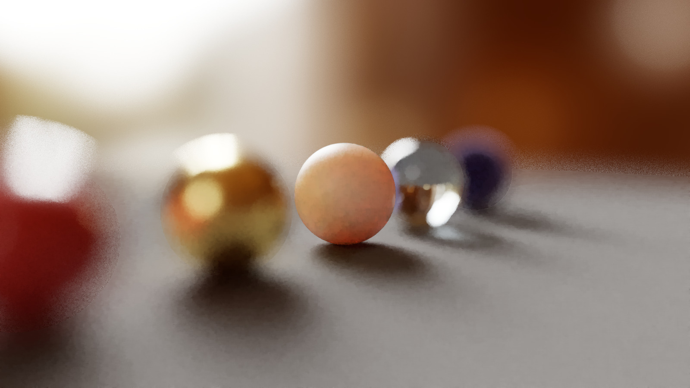

<p align="center"><sub>Rendered inside SubCraft with the built-in path tracer: clear coat, metal, subsurface, glass and sheen, depth of field and an HDRI backdrop.</sub></p>

Paint on 3D models with layered PBR materials, masks, generators and smart materials, bake mesh maps
and export game-ready textures. Runs on Windows and Linux, with experimental macOS and Arm builds.
New here? Read the [getting-started guide](docs/getting-started.md): the app opens on a ready model,
so you can paint right away.

> **Status: usable, still young.** Painting, layers, baking, smart materials, save / load and export work
> and are covered by tests. Expect rough edges. Release notes: [CHANGELOG.md](CHANGELOG.md).
> SubCraft is an independent project, not affiliated with or endorsed by Adobe or ArtCraft.

## New in 0.6.0

- **51 procedural materials with sliders**: weathered metals, paints, plastics, fabrics, stone and wood,
  plus a new **stylized hand-painted** family. Wear, Age and Dirt sliders change the whole look, and you
  can add sliders of your own to any fill or folder.
- **Material filters**, like Painter's MatFinish and MatFX: Galvanized, Hammered, Powder Coated, Brushed,
  Edge Damages, Rust Weathering, Peeling Paint, Water Drops, Baked Lighting and more, plus **PBR Validate**.
- **New generators**: Dripping Rust, Fiber Glass Edge Wear and Mask Builder, and 19 new smart masks.
- **Stitches**: stitch with the Pen, stitch tiles from images, and the **Auto Stitcher**, which places
  stitches along UV seams, open borders or a mask edge. Stitches run over UV seams without breaking.
- **Decals**: drop an image or a normal map on the model and place it; it can wrap around hard edges.
- **Viewport and path tracer**: clear coat, sheen, anisotropy, subsurface, translucency, glass and a
  displacement preview in the viewport; better reflections, contact shadows and SSR; a path tracer with
  depth of field and an HDRI backdrop.
- **Graph materials as layers**: load Substance archives (`.sbsar`) and MaterialCraft materials
  (`.mcmat`, `.mcraft`, `.sbs`) as fill layers, with their exposed parameters as live sliders.
- **Live link** to Unity, Unreal and Godot keeps the engine's textures current while you paint
  ([how it works](docs/live-link.md)).
- **Plugins and scripting**: shareable plugins that add scripts, smart materials, masks, brushes and export presets ([docs](docs/plugins.md)), and Rhai scripts with the same API AI agents use ([docs](docs/scripting.md)).
- More tools: Heal, Shape fill, Liquify push, particle trails, stencils from the shelf, pen tilt and
  rotation, UV island editing, multiple UV sets, physical size for fills, version history, bake presets
  and GPU high-poly projection when baking.
- **Linux AppImage and Flatpak** packages next to the tar.gz.

## Editor themes

Three built-in themes: pick one in **Settings > General**, or start with `--theme dark|light|painter`.

| Dark | Light | Painter |
|:---:|:---:|:---:|
| 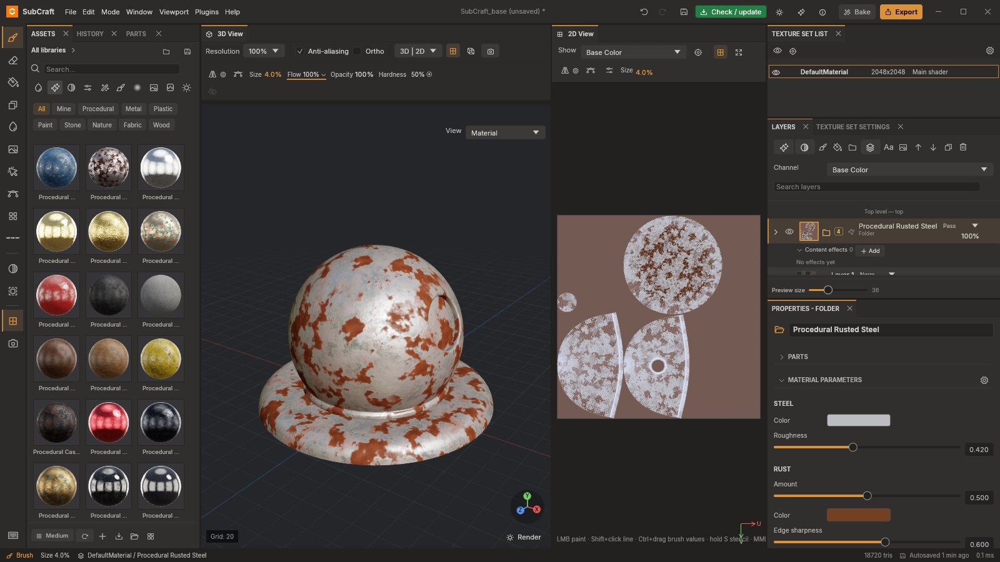 | 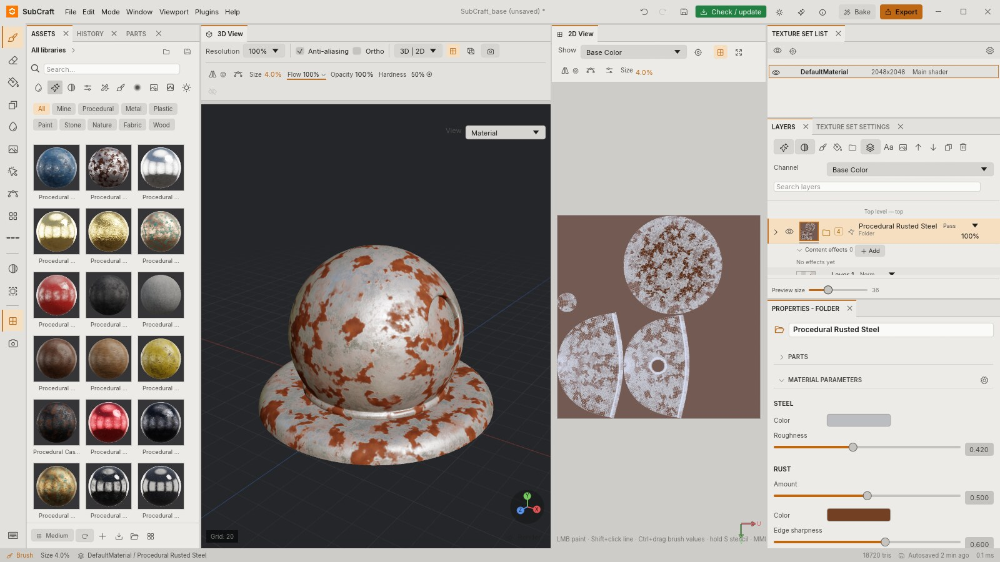 | 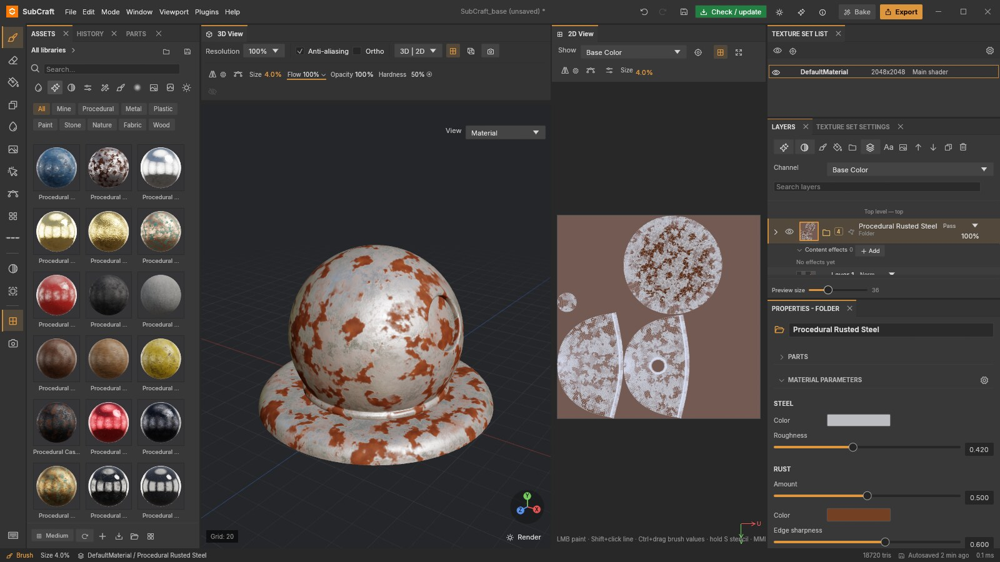 |

## New materials

**Procedural materials** come with their own sliders. Apply one, select its folder and drag Wear, Age or
Dirt: the same material goes from factory new to rusted through.

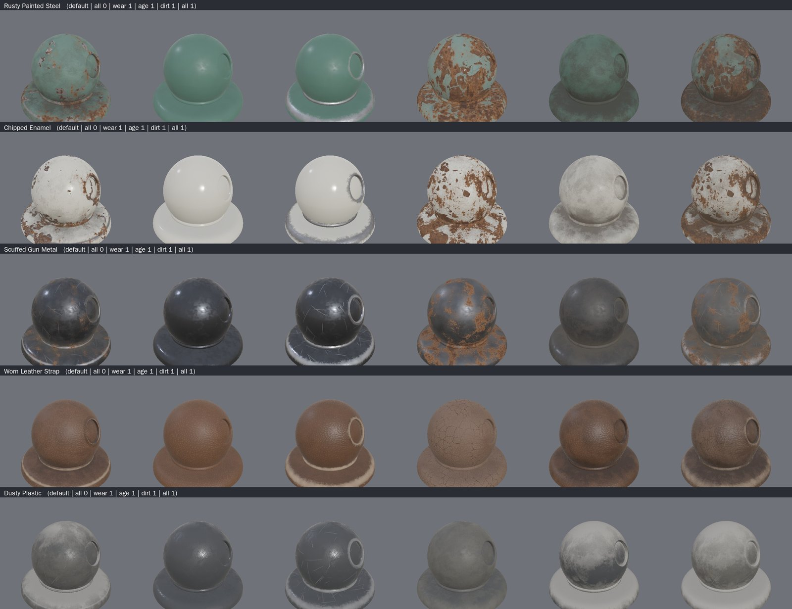

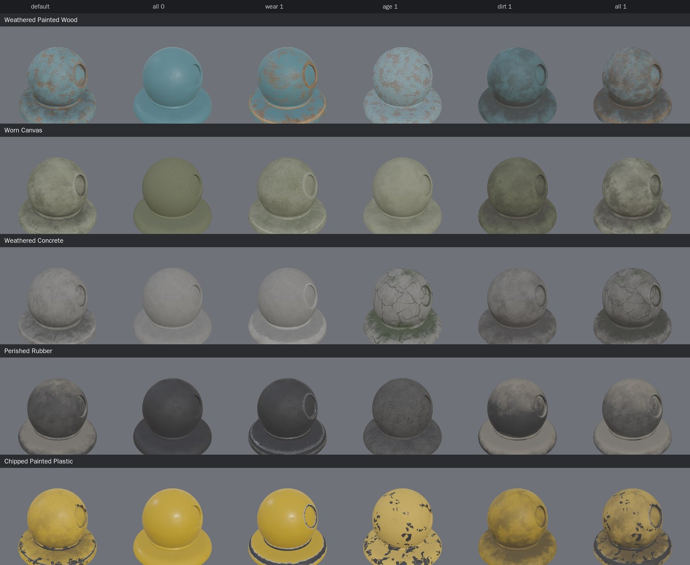

**Stylized hand-painted materials**: soft painted light, cavity shading and edge highlights that hold up
without any real lighting, for stylized and mobile games.

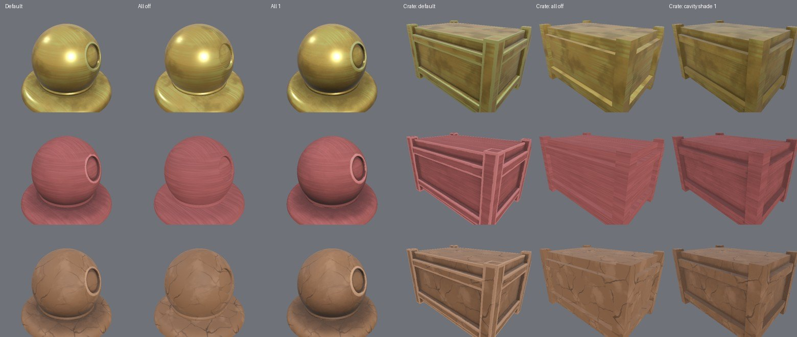

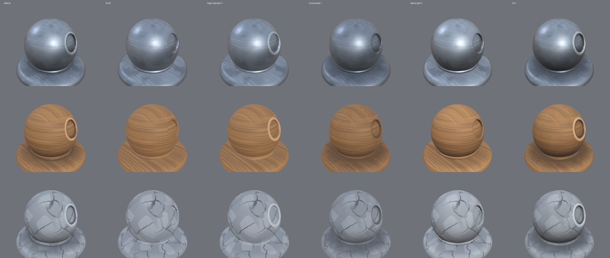

**Smart masks** for dust, dirt, leaks, wear, drips and fibre edges. Drop one on a layer and it follows the
shape of the model.

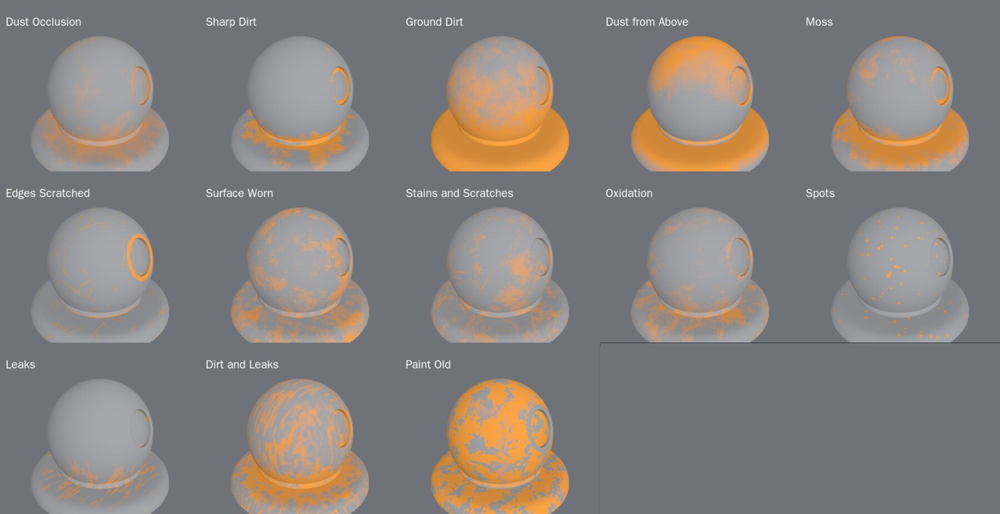

## A full shelf

Besides the new ones, the shelf holds 90 smart materials, 63 smart masks, PBR texture materials, brushes,
alphas, grunges, normal stamps and 10 HDRI environments. A small sample:

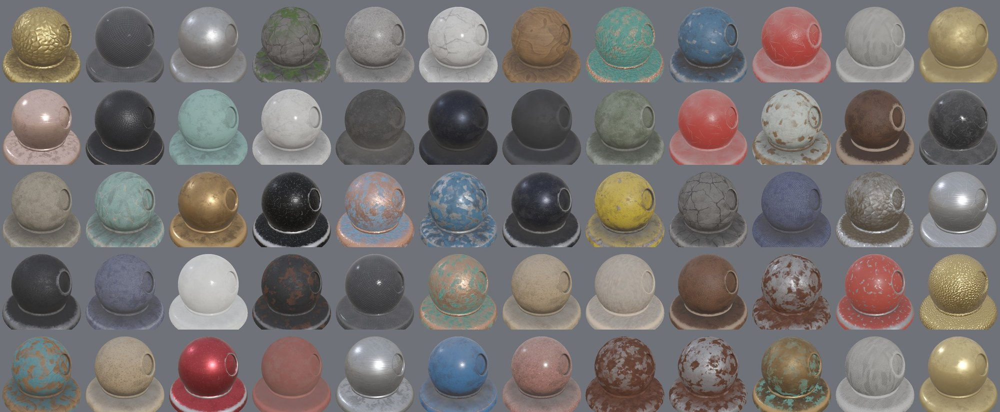

## Filters, stitches and rendering

**Material filters** rewrite the material below them in one step: Base Color, Roughness, Metallic and
Height together.

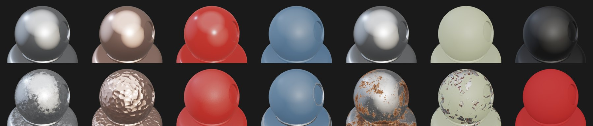

**Auto Stitcher**: pick a stitch, choose UV seams, open borders or a mask edge, and SubCraft lays the
stitches along it. More in [docs/stitches.md](docs/stitches.md).

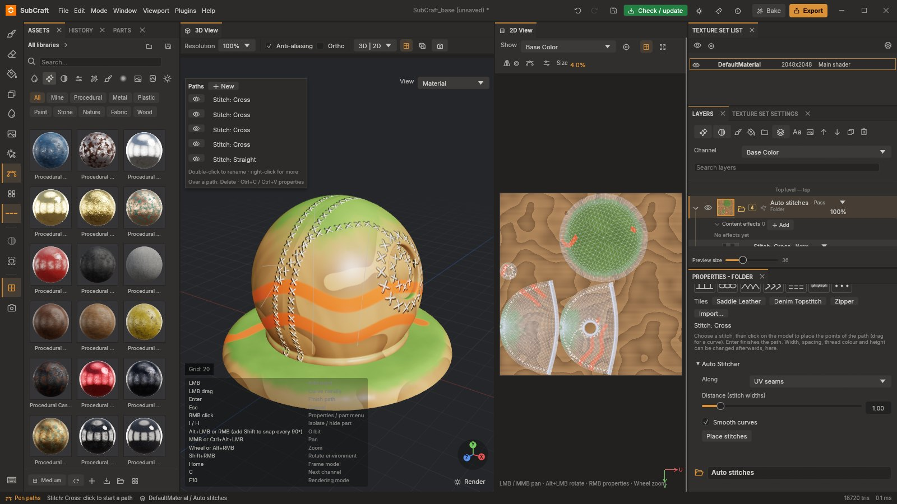

**Viewport and path tracer**: the real-time viewport now shades clear coat, sheen, anisotropy, subsurface,
glass and displacement, and **Rendering mode** (F10) path traces the same materials.

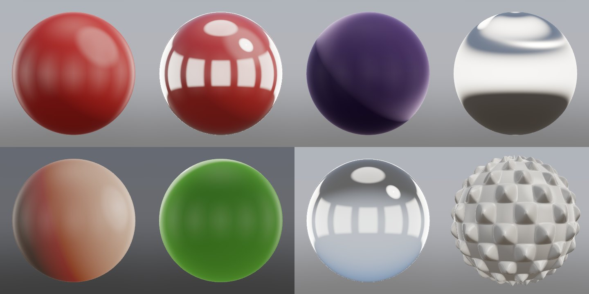

## Features

**Painting.** Brush, eraser, clone, heal, smudge and liquify, stencils, polygon and shape fill, projection,
particle brushes and editable pen paths (Bezier, ribbons, stitches). Symmetry, lazy mouse, stabilizer,
tablet pressure, tilt and rotation. Paint in 3D or straight in the 2D UV view, across UDIM tiles as one surface.

**Layers, masks and generators.** Paint and fill layers, folders, 32 blend modes, anchors, masks with stacked
effects. Generators: Edge wear, Dirt, Cavity, Curvature, Ambient Occlusion, Dripping Rust, Fiber Glass,
Mask Builder, Cracks, Streaks, Scratches, gradients and more, all able to react to painted relief.
Filters from Blur and Levels to Warp, Kuwahara, Color Match and the material filters.

**Baking.** Normal (from a high poly, with cage), world normal, Ambient Occlusion, Curvature, Thickness,
Position, ID, Height and Bent Normal, on the GPU and in the background, with saveable bake presets.

**Viewport.** Real-time PBR with studio or HDRI lighting, tone mapping, bloom, AO, SSR, depth of field and
colour LUTs, a path-traced Rendering mode, Render image (up to 4096 px) and Turntable (PNG frames and a GIF).
GPU layer compositing for 2048 and larger sets, with automatic processor fallback.

**Interface.** Three themes, a Painter-style layout, Painter or Blender navigation, a Substance Painter
shortcuts preset, and English, Korean (한국어) and Traditional Chinese (繁體中文).

**Import, export and automation.** OBJ, glTF / GLB, FBX, USD, Alembic, PLY and STL, with multiple UV sets.
**Open Substance Painter `.spp` projects** and rebuild their layer stacks; use `.sbsar` and MaterialCraft graphs as layers. Export presets for
Unreal, Unity, Godot, glTF, Roblox and Sketchfab, live link to game engines, autosave, version history and
crash recovery. Rhai [scripting](docs/scripting.md) and `subcraft-mcp`, a headless
[MCP](https://modelcontextprotocol.io) server so AI agents can texture models with the same engine
([details](apps/subcraft-mcp/README.md)).

**Performance.** Texture data is stored in tiles, so only the tiles you touch are recomposited, saved and
uploaded. On an RTX 4060 at 4096 x 4096, a layer toggle on a 33-layer stack takes about 0.5 s and a 300 px
brush stamp about 17 ms. Details: [`docs/performance.md`](docs/performance.md).

## Install

### Windows

1. Download **`SubCraft-<version>-setup.exe`** from the [latest release](https://github.com/Aalzard/subcraft/releases/latest).
2. Run it. SmartScreen may say "Windows protected your PC" because the installer isn't code-signed yet
   (see the [code signing policy](docs/CODE_SIGNING.md)): click **More info → Run anyway**.
3. Start SubCraft from the Start Menu. The green **Check / update** button installs later releases.

Prefer no installer? Download **`SubCraft-<version>-windows-x64.zip`**, unzip it and run `SubCraft.exe`.
Needs Windows 10 or 11, 64-bit, and a GPU with DirectX 12 (Vulkan also works: set `WGPU_BACKEND=vulkan`).

### Linux

- **tar.gz**: download **`SubCraft-<version>-linux-x86_64.tar.gz`**, unpack it (`tar -xzf SubCraft-*.tar.gz`)
  and run `./install.sh` to add SubCraft to your application menu (no root needed), or just `./subcraft`.
  Updates itself from the app.
- **AppImage**: download **`SubCraft-<version>-linux-x86_64.AppImage`**, `chmod +x` it and run it. To
  update, download the new AppImage.
- **Flatpak**: `flatpak install --user SubCraft-<version>-linux-x86_64.flatpak` (it fetches the
  freedesktop runtime from Flathub), then start it from the menu or with `flatpak run io.github.aalzard.SubCraft`.
  To update, `flatpak uninstall --user io.github.aalzard.SubCraft` (your settings stay) and install the new file.

Needs a Vulkan driver (Mesa or your GPU vendor's) and X11 or Wayland. Built on Ubuntu 22.04, so it runs on
that and newer distributions.

### Other platforms (experimental)

| Platform | Package | Status |
|---|---|---|
| macOS, Apple Silicon and Intel | `SubCraft-<version>-macos-universal-experimental.dmg` | Not notarized, no in-app updates |
| Linux aarch64 (Arm64) | `SubCraft-<version>-linux-aarch64.tar.gz` | In-app updates |
| Windows on Arm | `SubCraft-<version>-windows-arm64.zip` | In-app updates, no installer |

These are built automatically and only compile-checked so far; please report what works. On macOS the first
launch is blocked by Gatekeeper: open **System Settings → Privacy & Security** and click **Open Anyway**,
or run `xattr -dr com.apple.quarantine /Applications/SubCraft.app`.

### Verifying a download

Every release file is built by GitHub Actions with a build provenance attestation:
`gh attestation verify <file> --repo Aalzard/subcraft`. Checksums are in `SHA256SUMS.txt` on the release page.

**[Code signing policy](docs/CODE_SIGNING.md):** Free code signing provided by SignPath.io, certificate by
SignPath Foundation (pending approval; until then Windows releases are unsigned and say so in their notes).

## Build from source

You need a recent stable [Rust toolchain](https://rustup.rs) (1.95 or newer) and a GPU with Vulkan,
Metal or DirectX 12.

```sh
git clone https://github.com/Aalzard/subcraft.git
cd subcraft
cargo run --release
```

Try `cargo run --release -- --demo` for a ready-made layer stack. On Linux you may need
`libxkbcommon-x11-0 libegl1` and a Vulkan driver. Packaging and platform scripts are in
[`docs/development.md`](docs/development.md), design decisions in [`docs/adr`](docs/adr).

## Contributing

Bug reports, feature ideas, docs and code are all welcome. Please read
[`CONTRIBUTING.md`](.github/CONTRIBUTING.md) first, and follow the [Code of Conduct](.github/CODE_OF_CONDUCT.md).

## Support SubCraft

SubCraft is free and developed in spare time. If it is useful to you, you can
[support its development with a donation](https://www.paypal.com/donate/?hosted_button_id=UFCVX9QYCB8F8).

## License

SubCraft is dual-licensed under either of [Apache License, Version 2.0](LICENSE-APACHE) or
[MIT License](LICENSE-MIT), at your option. Unless you explicitly state otherwise, any contribution
intentionally submitted for inclusion in SubCraft by you, as defined in the Apache-2.0 license, shall be
dual licensed as above, without any additional terms or conditions.

## Credits

- Bundled third-party assets keep their own licenses: the [Inter](https://rsms.me/inter/) font
  (SIL Open Font License 1.1) and [Phosphor Icons](https://phosphoricons.com) (MIT), both in
  `crates/ui/assets/fonts` with their license files.
- The starter pack (110 normal maps, 84 brush alphas) is CC0:
  [credits](assets/starter-pack/CREDITS-CC0.txt). The bundled HDRIs are CC0:
  [credits](assets/environments/CREDITS-CC0.txt). The generators' grunge map is CC0:
  [credits](assets/grunge/CREDITS-CC0.txt).
