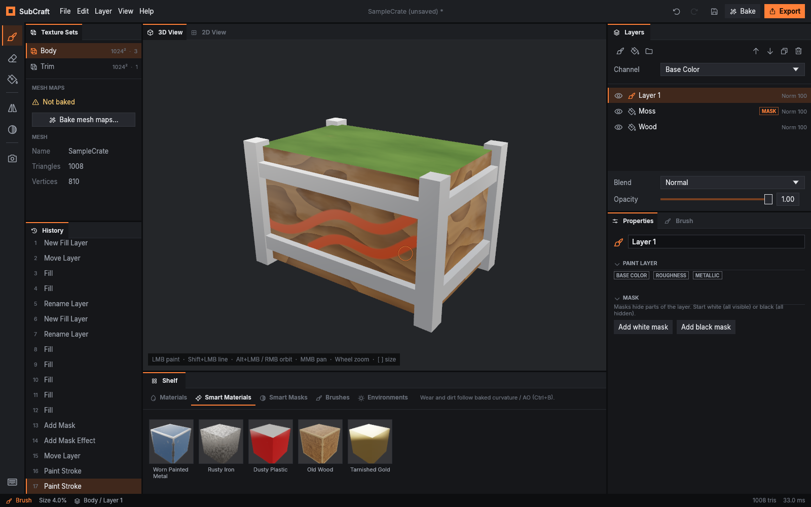
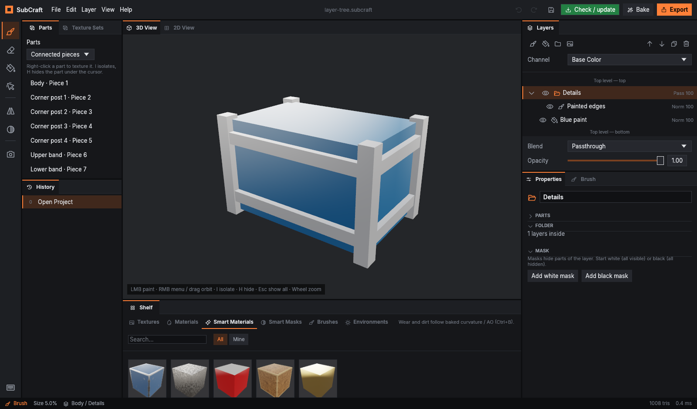
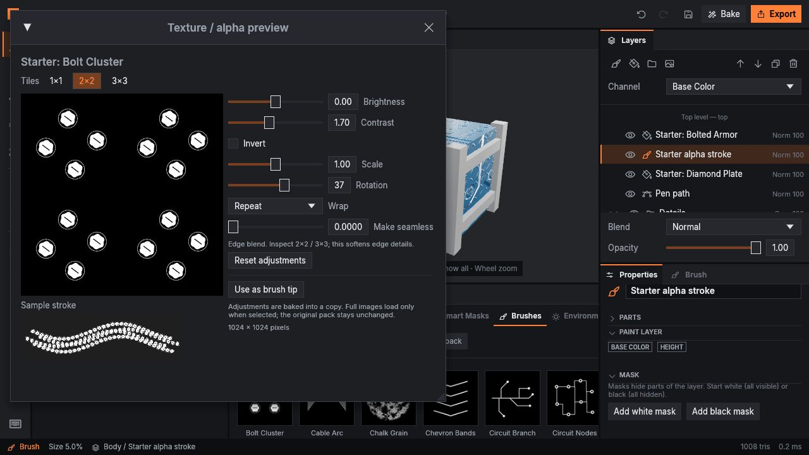
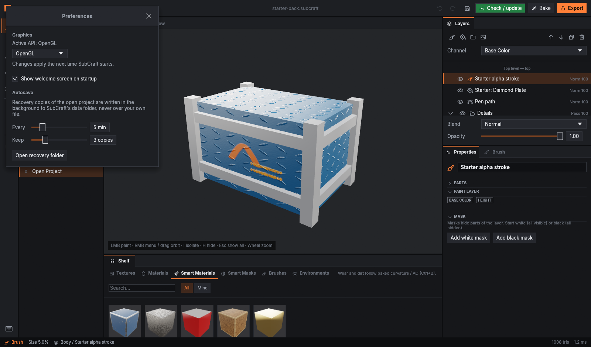
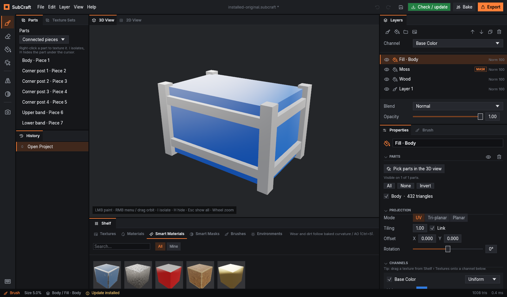
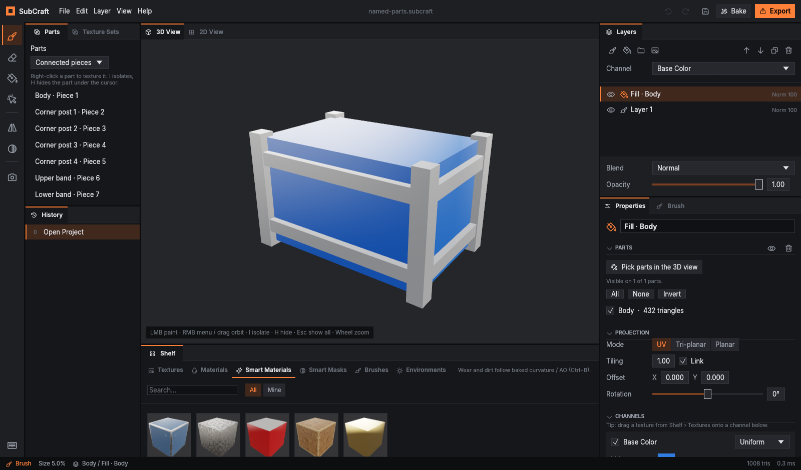

# SubCraft

[](https://aalzard.github.io/subcraft/)
[](https://github.com/Aalzard/subcraft/releases/latest)
[](https://github.com/Aalzard/subcraft/releases/latest)
[](https://github.com/Aalzard/subcraft/releases/latest)

An independent, open-source 3D texture painting application in the spirit of Substance Painter,
written in Rust. Paint directly on 3D models with layered PBR materials, masks, generators and
smart materials, bake mesh maps, and export game-ready textures.

**SubCraft is an independent project. It is not officially developed by, affiliated with,
or endorsed by ArtCraft.**



> **v0.1.5** adds the 60-image starter pack, texture/alpha previews, editable pen paths, layer
> dragging/folders/rename and the welcome guide. Browser Export downloads all maps in one ZIP.
> On desktop v0.1.4, use the green **Check / update** button. Earlier versions need one download
> to get the button. See the [changelog](CHANGELOG.md).

New here? Follow the [illustrated getting-started guide](docs/getting-started.md). A welcome
screen and six-step in-app guide are available on desktop and in the browser.

> **Status: early but usable.** The core engine, painting, baking, smart materials, save/load and
> export all work and are covered by tests. Expect rough edges, missing features and breaking
> changes to the project file format. See [`docs/progress.md`](docs/progress.md) for what is done
> and what comes next.

## Features

- **Welcome and quick start**: open a model/project, try the sample, see what's new, or follow
  the six-step guide from Help. Desktop recent files make it easy to resume; the startup screen
  can be turned off on the welcome screen or in Preferences. The hub fits narrow windows.
- **Layer stack**: paint layers, fill layers (uniform, procedural, image and mesh-map sources) and
  folders, with 32 blend modes and opacity per channel. Right-click a layer to duplicate, delete or
  save it to your library.
- **Layer tree editing**: drag a layer's name or row above/below another
  layer; drop in the center of a folder to put it inside. Drop at **Top level — top/bottom** to
  move it out. Folder arrows expand/collapse; double-click a name or press **F2** to rename
  inline (**Enter** accepts, **Esc** cancels). Moves and renames support undo/redo and project
  save/load. Folder drop zones and rename are adapted from
  [CalangoTech's Studio fork](https://github.com/CalangoTech/subcraft/commit/bd6c064).

  

- **PBR channels**: base color, roughness, metallic, normal, height (shown as bumps), ambient occlusion.
- **Your own textures**: use any image (PNG, JPG, TGA, TIF, EXR…) in a fill layer with UV, tri-planar or
  planar projection, or **import a whole texture set** (base color, roughness, normal, height…) as one
  material: files are matched by name, glossiness and DirectX normals are converted automatically.
  Images are stored inside the project, so it stays portable. Imported images show up in
  **Shelf → Textures**: drag one onto a channel (Base Color, Normal, Roughness…) to use it there.
  Tile X and Y separately, and set each channel's **strength** (normal / height strength, roughness,
  metallic, base color brightness, emissive intensity).
- **Masks**: paintable masks with stacked effects: Edges (curvature), Cavity (AO), Directional,
  Position gradient, noise fills, **images** (e.g. a logo), Levels and Invert.
- **Parts workflow**: right-click the piece under the cursor to fill it, paint only there, mask
  the selected layer or add a generator mask. Switch between connected pieces, UV islands,
  imported objects and material IDs. **I** isolates, **H** hides the part under the cursor,
  **Esc** restores all parts. View visibility doesn't change exported textures. OBJ, FBX and
  glTF/GLB object names are kept in saved projects (schema 3; older projects still open).
  Moving across parts keeps the model's displayed colors unchanged, including part-picking mode.
- **Eyedropper**: pick linear material values before lighting; Shift+click with the eyedropper
  picks all channels. Adapted from [CalangoTech's SubCraft Studio fork](https://github.com/CalangoTech/subcraft).
- **Painting**: brush and eraser on the 3D model with tips (alphas), symmetry, lazy mouse, jitter,
  **stencils** (paint through an image laid over the view) and polygon fill (triangle, mesh part,
  UV island). Save your brush setups as **presets**.
- **Pen paths**: press **P**, click to add anchors and drag for Bézier
  handles in the 3D or 2D view. Drag anchors/handles to edit; **Shift** moves one handle separately,
  **Delete** removes a point, **Enter** finishes and **Esc** cancels the current edit. Properties
  offers New path, Corner/Smooth, Closed path, UV width, hardness, opacity and channel values.
  Paths remain editable in saved projects and support undo/redo. Their rasters are computed
  across frames. Use the 2D view for handles outside UV islands, and separate paths across UV
  seams; overlapping UVs share texels. Pen uses round strokes; alpha tips and symmetry belong to
  Brush. New projects use schema 4; earlier project files still open.

  

- **Baking**: normal (from an optional high poly through a cage), world-space normal, AO, curvature,
  thickness, position and ID maps, on the CPU in the background.
- **Shelf**: built-in materials, smart materials (Worn Painted Metal, Rusty Iron, Old Wood…),
  smart masks, brush tips and lighting environments (including HDRI import). Search/filter by
  category and drag items onto the model or a layer.
- **CC0 Starter pack**: **30 normal maps and 30 brush alphas**. Find normals under
  Textures → Starter pack and drag onto Normal, or the model/layers; find tips under Brushes.
  Click an image to inspect 1×1 / 2×2 / 3×3 tiles, a lit normal preview or sample alpha stroke.
  Adjust normal strength/green convention, brightness/contrast for tips, invert, scale, rotation,
  repeat/mirror/clamp and seamless edge blending, then apply a copy. Tileable normals have a
  filter chip. Desktop carries the images offline; web loads full PNGs on demand. The pack is
  12.9 MB losslessly compressed, with 340 KB of thumbnails. See [CC0 credits](assets/starter-pack/CREDITS-CC0.txt).

  

  
- **Your library**: imported tips and HDRIs, your saved smart materials, smart masks and brush presets
  live in `Documents\SubCraft\Library` and are back every time you start SubCraft.
- **Viewport**: real-time PBR preview with studio or HDRI lighting, plus a 2D UV view of every channel
  and baked map.
- **Graphics API** (next desktop release): Edit → Preferences → Graphics offers Automatic,
  DirectX 12 (Windows) and OpenGL (Windows/Linux), and shows the API currently running. Save
  your project and restart to apply a change. Startup errors retry Automatic with an explanation.
  An explicit `WGPU_BACKEND` environment setting takes precedence. The browser chooses its own API.

  
- **Autosave and crash recovery**: a recovery copy of your project is saved in the background
  every few minutes (Edit → Preferences) to SubCraft's data folder, never over your own file. If
  SubCraft crashes or is closed by force, it offers to bring your work back on the next start.
- **Bug reports**: Help → Report a bug… opens a GitHub issue with your version, OS and GPU filled
  in. Logs and crash reports stay on your PC (`%LOCALAPPDATA%\SubCraft`) until you attach them.
- **Desktop updates** (v0.1.4): the green **Check / update** button downloads the latest
  stable release, verifies it, installs and restarts with your unsaved project restored.
  Installed Windows copies use the installer; portable Windows/Linux x64 copies replace their
  executable. Windows asks for permission when updating an all-users installation.
- **Projects and export**: `.subcraft` project files; export templates for PBR metal/rough, Unreal
  (ORM + DirectX normal), Unity HDRP (mask map) and glTF. Browser Export downloads one ZIP
  containing all texture maps; extract it into a folder.
- **Mesh import**: OBJ, glTF / GLB and FBX.

## Try it in your browser

Open **https://aalzard.github.io/subcraft/** in a browser with WebGPU (recent Chrome, Edge,
Firefox or Safari). Nothing to install. The web version is the same app with a few differences:

- **Files**: *Open* uploads from your computer; *Save* and *Export* download the files.
  Import OBJ, glTF or **GLB** (upload a `.gltf` together with its `.bin`). FBX is desktop only.
- **Speed**: it runs on one CPU thread, so big fills, smart materials and baking take longer
  than in the desktop app (the page pauses briefly while they compute).
- **No library folder**: imported textures, brush tips and HDRIs last for the session only.
- **No autosave**: the browser can't write files in the background, so SubCraft reminds you to
  download a backup of unsaved work every few minutes, and asks before you close the tab.

For real work, the desktop app below is faster.

**v0.1.5 sizes** (decimal MB):

| Download | Size |
|---|---:|
| Windows installer | 23.22 MB |
| Windows portable ZIP | 24.87 MB |
| Linux x64 archive | 26.39 MB |
| Browser WebAssembly module | 16.74 MB |

The browser module includes the thumbnail catalog. A fresh public HTTPS fetch transferred
5.60 MB in 3.00 seconds on the test connection; startup also compiles the module and sets up the
GPU. The 12.93 MB of full starter PNGs are separate files fetched only when selected. Connection,
cache, hardware and the selected images affect actual transfer size and loading time.

## Download (Windows)

1. Open the [latest release](https://github.com/Aalzard/subcraft/releases/latest) and download
   **`SubCraft-<version>-setup.exe`** under **Assets**.
2. Run it. Windows SmartScreen may say "Windows protected your PC" because the installer isn't
   code-signed yet: click **More info → Run anyway**.
3. Follow the steps (you can choose "Install for me only" if you don't have admin rights), then
   start SubCraft from the Start Menu. Uninstall it any time from **Settings → Apps**.

Prefer no installer? Download **`SubCraft-<version>-windows-x64.zip`** instead, unzip it and run
`SubCraft.exe`. Either way, any GPU with DirectX 12 works (SubCraft uses Direct3D 12 on Windows; to
try Vulkan instead, set the environment variable `WGPU_BACKEND=vulkan`).

The installer replaces an earlier installed version. Versions through v0.1.3 need one download
to get the new green **Check / update** button. Once you have it, click the button in the top bar
to install future stable releases and restart with your project restored. Wait until release
packages finish uploading if the app says they are still being prepared.



*Local installer update test: the original project and unsaved layer edits are restored.*

The [latest release](https://github.com/Aalzard/subcraft/releases/latest) has the current desktop
packages; the browser version updates separately when changes land on main. Features in open
pull requests are available after they are merged and released.

## Download (Linux)

1. Download **`SubCraft-<version>-linux-x86_64.tar.gz`** from the
   [latest release](https://github.com/Aalzard/subcraft/releases/latest) and unpack it:
   `tar -xzf SubCraft-*-linux-x86_64.tar.gz`
2. Run `./install.sh` inside the folder to add SubCraft to your application menu (installs to
   `~/.local`, no root needed; `./install.sh --uninstall` removes it), or just start `./subcraft`.

Needs a Vulkan driver (Mesa or your GPU vendor's) and X11 or Wayland. Built on Ubuntu 22.04, so it
runs on that and newer distributions.

## Building from source

You need a recent stable [Rust toolchain](https://rustup.rs) (1.95 or newer) and a GPU with
Vulkan, Metal or DirectX 12 support.

```sh
git clone https://github.com/Aalzard/subcraft.git
cd subcraft
cargo run --release
```

The app opens with a sample crate. Try `cargo run --release -- --demo` for a ready-made layer
stack, or pass a mesh / project file: `cargo run --release -- path/to/model.fbx`.

Step-by-step Windows setup, the daily workflow and building the `.exe` yourself:
[`docs/development.md`](docs/development.md).

On Linux you may need the usual windowing libraries (for example on Debian / Ubuntu:
`libxkbcommon-x11-0 libegl1`) and a Vulkan driver.

### Controls

| Action | Input |
| --- | --- |
| Paint / erase | Left mouse (B = brush, E = eraser) |
| Straight line | Shift + click |
| Orbit | Alt + left mouse, or right mouse |
| Part actions | Right click without dragging |
| Isolate / hide hovered part | `I` / `H` in the 3D view |
| Show all parts | `Esc` in the 3D view, or Parts → Show all parts |
| Pan | Middle mouse |
| Zoom | Mouse wheel, or Alt + right mouse |
| Brush size | `[` and `]` |
| Move / rotate / scale stencil | Hold S + middle / left / right mouse |
| Paint without the stencil | Hold N |
| Apply a shelf item | Click it, or drag it onto the model or a layer |
| Bake mesh maps | Ctrl + B |
| Export textures | Ctrl + Shift + E |
| Undo / redo | Ctrl + Z / Ctrl + Y |

Help → Keyboard shortcuts lists all of them.



## Project layout

SubCraft is a Cargo workspace of small crates with a strict dependency direction (lower crates
never depend on higher ones, and only the rendering and UI crates know about the GPU or egui):

```
core ← image ← mesh / doc ← materials ← compositor / paint / bake ← project / export / assets ← app ← ui ← apps
```

| Crate | Purpose |
| --- | --- |
| `crates/core` | IDs, channel kinds, shared math types |
| `crates/image` | Tiled copy-on-write texel storage, image I/O |
| `crates/mesh` | Mesh model, importers, tangents, BVH, UV rasterization |
| `crates/doc` | Document model: texture sets, layers, masks, undo history |
| `crates/materials` | Procedural patterns, projections, sampling |
| `crates/compositor` | CPU layer compositing with dirty-tile caching |
| `crates/paint` | Brush engine, stroke placement, symmetry |
| `crates/bake` | Mesh-map baking |
| `crates/project`, `crates/export`, `crates/assets` | Project files, texture export, built-in assets |
| `crates/app` | Session and commands (all editing goes through here) |
| `crates/render` | wgpu viewport renderer |
| `crates/ui` | egui interface |
| `apps/subcraft` | The executable |

Design decisions are recorded in [`docs/adr`](docs/adr).

## Contributing

Contributions are very welcome: bug reports, feature ideas, docs and code. Please read
[`CONTRIBUTING.md`](CONTRIBUTING.md) first; it explains how to build, test and structure changes.
Everyone taking part is expected to follow the [Code of Conduct](CODE_OF_CONDUCT.md).

## License

SubCraft is dual-licensed under either of

- [Apache License, Version 2.0](LICENSE-APACHE)
- [MIT License](LICENSE-MIT)

at your option.

Unless you explicitly state otherwise, any contribution intentionally submitted for inclusion in
SubCraft by you, as defined in the Apache-2.0 license, shall be dual licensed as above, without any
additional terms or conditions.

Bundled third-party assets keep their own licenses: the [Inter](https://rsms.me/inter/) font
(SIL Open Font License 1.1) and [Phosphor Icons](https://phosphoricons.com) (MIT), both in
`crates/ui/assets/fonts` with their license files.
