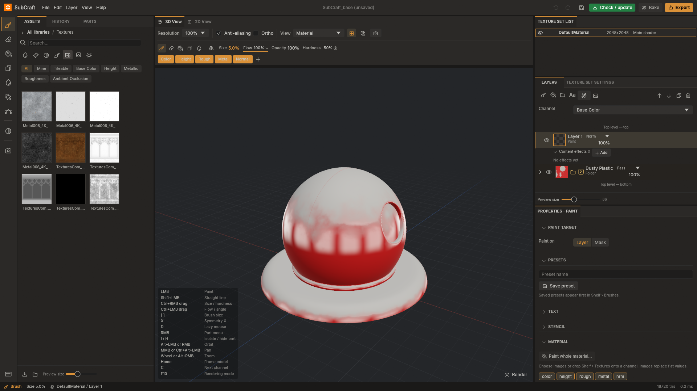
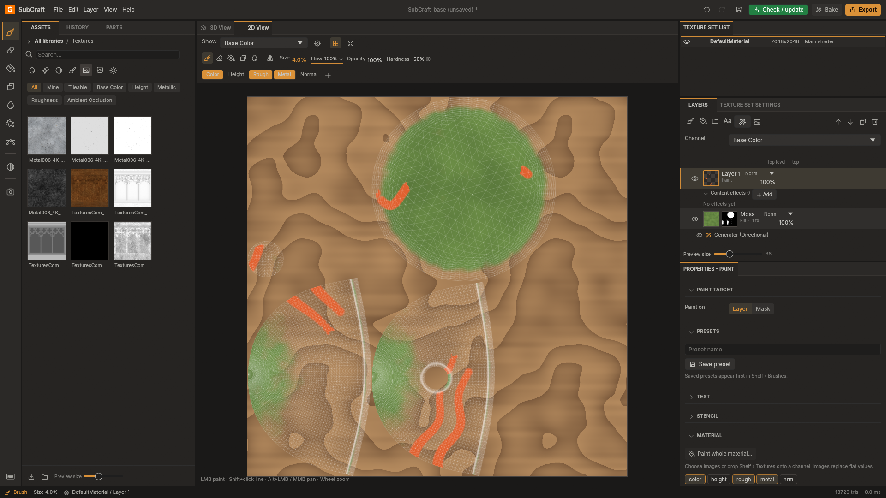
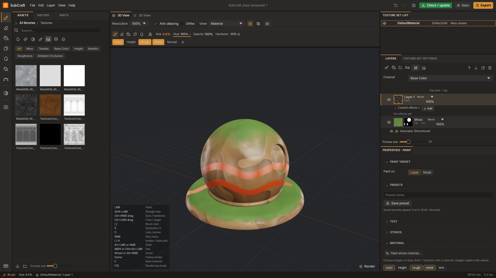
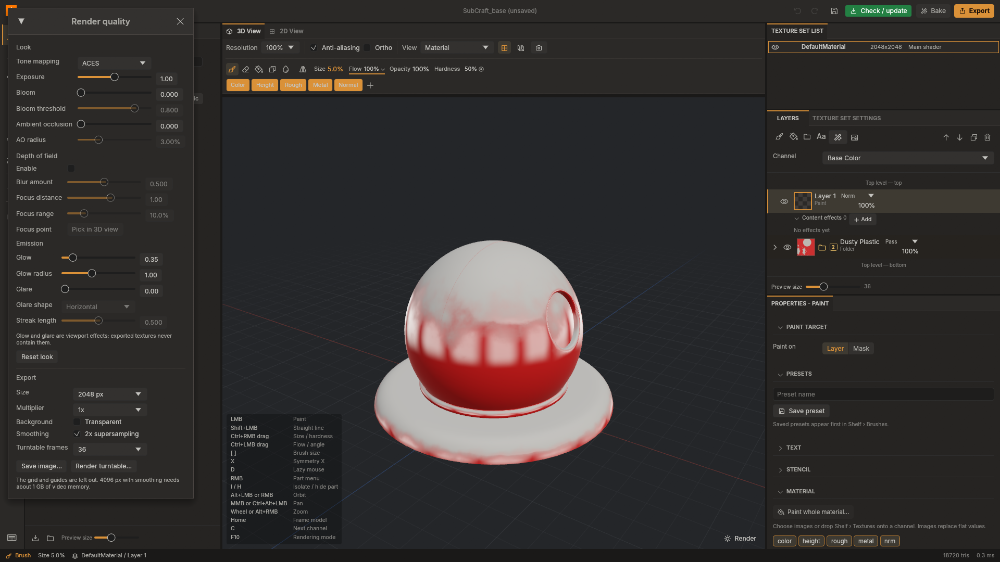
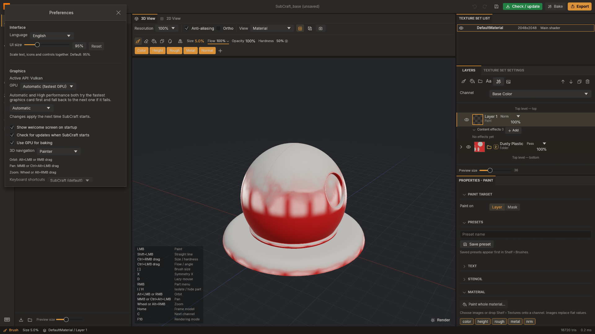

<p align="center"></p>

# SubCraft

[](https://github.com/Aalzard/subcraft/releases/latest)
[](https://github.com/Aalzard/subcraft/releases/latest)
[](https://github.com/Aalzard/subcraft/releases/latest)
[](https://www.paypal.com/donate/?hosted_button_id=UFCVX9QYCB8F8)

**An independent, open-source 3D texture painting app in the spirit of Substance Painter, written in Rust.**
Paint directly on 3D models with layered PBR materials, masks, generators and smart materials,
bake mesh maps and export game-ready textures. Windows and Linux.



*The Painter-style layout on the bundled SubCraft_base model: Assets shelf with normal-map tiles (left), 3D view (center), texture set list, layers (Dusty Plastic smart material with a Directional generator mask, Dirt generator) and Properties (right).*

> **Status: early but usable.** Painting, layers, baking, smart materials, save/load and export work
> and are covered by tests. Expect rough edges and breaking changes to the project file format.
> See [`docs/progress.md`](docs/progress.md) for what is done and what comes next.
> SubCraft is an independent project, not affiliated with or endorsed by ArtCraft.

New here? Follow the [illustrated getting-started guide](docs/getting-started.md); a welcome screen
and a six-step in-app guide are included. The app opens on the bundled **SubCraft_base** model with a
2048 x 2048 texture set, so you can paint immediately. Release notes: [CHANGELOG.md](CHANGELOG.md).

## Highlights

- **Paint on the model**: brush, eraser, clone, smudge, stencils, polygon fill and editable pen paths,
  with symmetry, lazy mouse, tips and saveable presets.
- **Layer stack like Painter**: paint and fill layers, folders, masks, 32 blend modes, generators and
  filters, smart materials and smart masks.
- **Bake and export**: nine mesh maps (the ray-based AO, Curvature and Thickness bakes can run on the GPU), per-map export checkboxes and presets for
  Unreal, Unity HDRP / URP, Godot 4 and glTF.
- **Opens Painter projects**: read `.spp` files and rebuild their layer stacks; import OBJ, glTF / GLB,
  FBX, USD, Alembic, PLY and STL.
- **Fast at 2048 and 4096**: tiled texture storage, a GPU layer compositor and live-preview thinning for
  big brushes. See [Performance](#performance).
- **Your language**: English, Korean (한국어) and Traditional Chinese (繁體中文).

## Performance

Texture data is stored in tiles (`TiledImage`), never one dense bitmap per layer, so only the tiles you
touch are recomposited, saved and uploaded. The numbers below come from [`docs/performance.md`](docs/performance.md),
[`docs/progress.md`](docs/progress.md) and [`docs/performance/2026-10-28-gpu-bake.md`](docs/performance/2026-10-28-gpu-bake.md),
measured on one Windows PC with an RTX 4060 in release builds.

- **GPU layer compositing** (Preferences, "Use GPU for compositing"): on by default for texture sets of
  2048 x 2048 and larger. On a 4096 x 4096 stack of 33 layers, toggling a layer took about 0.49 s instead
  of 1.8 s, and an opacity edit about 0.5 s instead of 1.1-1.9 s. At 2048 the gain is smaller
  (about 80 ms instead of 95-110 ms per edit). Smaller sets, sets with blur-type filters and
  procedural-heavy stacks stay on the processor, which is also the fallback if the graphics card fails.
- **GPU baking**: Ambient Occlusion, Curvature and Thickness bakes at 4096 went from about 65-440 s on the
  processor to about 7-11 s on the GPU (roughly 2x to 40x depending on map and mesh).
- **Brush strokes**: with a 300 px soft brush a stamp costs about 3-5 ms at 2048 and about 17 ms at 4096.
  For expensive strokes (big brush, large texture) the live preview applies only every 2nd-3rd stamp while
  you draw and applies the rest exactly when you lift the pen; at 4096 the work while drawing dropped about
  2.5-3x, with a 0.15-0.25 s pause on release.
- **2048 is the default** texture resolution (256-4096 available). Saved projects keep their own resolution.
- **Allocator**: the app uses mimalloc; a full recomposite of the sample at 2048 takes roughly 0.13-0.5 s.

Where it is still limited: a 300 px brush at 4096 is smoother, not 60 fps; the GPU compositor does not
help stacks dominated by blur-type filters or procedural noise; a 4096 cold composite still takes over a
second; and the figures come from a single machine that was sometimes busy, so treat them as indicative,
not as guarantees.

## Features

### Painting and brushes
- Brush and eraser with tips (alphas), symmetry (mirror and radial), lazy mouse, jitter,
  flow / opacity / hardness, smoothing, scatter and **presets** you can save.
- **Clone** (Ctrl+click source) and **Smudge** on paint layers and masks. Clone copies from a point;
  there is no heal or seam blending.
- **Project from the view**: a brush image can be cast from the camera at the start of a stroke.
- **Stencils**, polygon fill (triangle, mesh part, UV island) and **pen paths** (press **P**; Bezier
  handles in 3D or 2D, paths stay editable).
- Paint in the 3D view or directly in the 2D UV view; Shift+click eyedropper picks all channels.



*The 2D view paints straight into the UV layout; the stack shown is the `--demo` project.*

### Layers, masks, generators and filters
- Paint layers, fill layers (uniform, procedural, image, mesh-map sources) and folders; 32 blend modes;
  drag to reorder, rename with F2, copy / paste and multi-select.
- **Masks** with stacked effects (Edges, Cavity, Directional, Position gradient, noise, images, Levels, Invert).
- **Generators**: Edges, Cavity, noise fills, Dirt, Cracks, Streaks, Speckles, Pores and Scratches.
- **Filters** on content, masks and folders, including Blur, Sharpen, Directional Blur, Highpass, Bevel,
  Levels, HSL, Gradient Map, Median, Warp, Histogram, Posterize and Mosaic.
- **Parts workflow**: right-click to fill or mask by connected piece, UV island, object or material ID;
  **I** isolates, **H** hides, **Esc** restores.

### Materials and Shelf
- 20 smart materials and 21 smart masks (edge and cavity ones need baked Curvature / AO), plus import and
  export of `.scsmart` files.
- Use your own images (PNG, JPG, TGA, TIF, EXR...) with UV, tri-planar or planar projection, or import a whole
  texture set matched by file name.
- CC0 starter pack of normal maps and brush alphas plus 10 bundled HDRI environments
  ([credits](assets/starter-pack/CREDITS-CC0.txt)). Your own library lives in `Documents\SubCraft\Library`.



*Paint layer over a masked fill with a Directional generator (the `--demo` project).*

### Baking
- Normal (optionally from a high poly through a cage), world-space normal, Ambient Occlusion, Curvature,
  Thickness, Position, ID, Height and Bent Normal, in the background with live results on the model.

### Text and decals
- **Text tool**: text layers with bidirectional text and shaping, embedded fonts and resolution-independent
  rasterization. Stencils and projected brush images cover decal-style work.

### Viewport and rendering


- Real-time PBR viewport with studio or HDRI lighting; tone mapping, bloom, ambient occlusion, depth of field
  (off by default), emission glow and glare. These are display-only and never change exported textures.
- Painter-style or Blender-style 3D navigation, wireframe overlay, camera bookmarks.
- **Render image** (1024-4096 px) and **Turntable** (numbered PNG frames; no GIF or MP4 encoder), and a
  path-traced Rendering mode.

### Projects, import and export
- **New Project window** shows triangles, materials, objects, UV range and warnings before you choose template,
  resolution, texture-set split, UDIM and normal format. UDIM tiles become one texture set each.
- Autosave and crash recovery, in-app update check, **Help > Report a bug** with version, OS and GPU filled in.
- Import: OBJ, glTF / GLB, FBX, USD (usd, usda, usdc, usdz), Alembic, PLY, STL; open Substance Painter `.spp`
  projects and read `.sbsar`. Project files are `.subcraft`.
- Export templates: PBR metal/rough, Unreal (ORM), Unity HDRP, Unity URP, Godot 4, glTF, Roblox and Sketchfab
  presets, 2D View export, and scene export (OBJ, glTF, GLB, USDA). Per-map checkboxes; Alt+click exports one map.

### Languages
- English, **한국어 (Korean)** and **繁體中文 (Traditional Chinese)**: Preferences > Interface > Language,
  applied immediately. CJK fonts are loaded from the system. See [`docs/localization.md`](docs/localization.md).



## Install

### Windows

1. Open the [latest release](https://github.com/Aalzard/subcraft/releases/latest) and download
   **`SubCraft-<version>-setup.exe`** under **Assets**.
2. Run it. Windows SmartScreen may say "Windows protected your PC" because the installer isn't
   code-signed yet: click **More info → Run anyway**.
3. Follow the steps (you can choose "Install for me only" if you don't have admin rights), then
   start SubCraft from the Start Menu. Uninstall it any time from **Settings → Apps**.

Prefer no installer? Download **`SubCraft-<version>-windows-x64.zip`** instead, unzip it and run
`SubCraft.exe`. Either way, any GPU with DirectX 12 works (SubCraft uses Direct3D 12 on Windows; to
try Vulkan instead, set the environment variable `WGPU_BACKEND=vulkan`).

The installer replaces an earlier installed version. Once you have a build with the green
**Check / update** button (v0.1.4 or newer), click it to install future stable releases and
restart with your project restored. Wait until release packages finish uploading if the app
says they are still being prepared.

### Linux

1. Download **`SubCraft-<version>-linux-x86_64.tar.gz`** from the
   [latest release](https://github.com/Aalzard/subcraft/releases/latest) and unpack it:
   `tar -xzf SubCraft-*-linux-x86_64.tar.gz`
2. Run `./install.sh` inside the folder to add SubCraft to your application menu (installs to
   `~/.local`, no root needed; `./install.sh --uninstall` removes it), or just start `./subcraft`.

Needs a Vulkan driver (Mesa or your GPU vendor's) and X11 or Wayland. Built on Ubuntu 22.04, so it
runs on that and newer distributions.

### Other platforms (experimental)

| Platform | Package | Status |
|---|---|---|
| Windows x64 | `SubCraft-<version>-setup.exe`, `...-windows-x64.zip` | Supported, signed, in-app updates |
| Linux x86_64 | `SubCraft-<version>-linux-x86_64.tar.gz` | Supported, in-app updates |
| macOS, Apple Silicon and Intel | `SubCraft-<version>-macos-universal-experimental.dmg` (or `.zip`) | Experimental, not notarized, no in-app updates |
| Linux aarch64 (Arm64) | `SubCraft-<version>-linux-aarch64.tar.gz` | Experimental, in-app updates |
| Windows on Arm | `SubCraft-<version>-windows-arm64.zip` | Experimental, in-app updates |

The experimental packages are built automatically by GitHub Actions (`release-platforms.yml`) and
have only been compile-checked by the maintainers so far; please report what works and what does not.

**macOS.** Open the disk image and drag `SubCraft.app` to Applications. The app is not signed with an
Apple Developer ID and not notarized, so the first launch is blocked by Gatekeeper: open **System
Settings → Privacy & Security** and click **Open Anyway**, or run
`xattr -dr com.apple.quarantine /Applications/SubCraft.app`. The build runs natively on Apple Silicon
and Intel (macOS 11 or newer) and uses Metal. Shortcuts use **Cmd** instead of Ctrl. To update, download the
new disk image.

**Linux aarch64** installs like the x86_64 package (`tar -xzf`, then `./install.sh`). It needs a
Vulkan driver for your GPU (Mesa panvk/freedreno/asahi/v3dv or a vendor driver) or, failing that,
OpenGL ES; on machines with only a software rasterizer (llvmpipe) it works but slowly.

**Windows on Arm** unzip and run `SubCraft.exe`. It uses Direct3D 12 and is a native Arm64 build.
There is no installer for Arm yet.

## System requirements

- **Windows** 10 or 11, 64-bit, with a GPU that supports DirectX 12 (Vulkan also works).
- **Linux** x86_64 (built on Ubuntu 22.04, runs on that and newer), a Vulkan driver (Mesa or
  your GPU vendor's) and X11 or Wayland.
- Memory use grows with texture resolution and layer count; no minimum has been measured.

## Shortcuts

Brush size `[` `]`, bake `Ctrl+B`, export `Ctrl+Shift+E`, undo / redo `Ctrl+Z` / `Ctrl+Y`, pen path `P`,
isolate / hide part `I` / `H`. **Help > Keyboard shortcuts** lists everything (searchable, with the Substance
Painter equivalent of each). Coming from Painter? Choose **Substance Painter** under Preferences > Keyboard
shortcuts; see [`docs/painter-shortcuts.md`](docs/painter-shortcuts.md).

## Build from source

You need a recent stable [Rust toolchain](https://rustup.rs) (1.95 or newer) and a GPU with
Vulkan, Metal or DirectX 12 support.

```sh
git clone https://github.com/Aalzard/subcraft.git
cd subcraft
cargo run --release
```

The app opens with the bundled SubCraft base model. Try `cargo run --release -- --demo` for a ready-made layer
stack, or pass a mesh / project file: `cargo run --release -- path/to/model.fbx`.

Step-by-step Windows setup, the daily workflow and building the `.exe` yourself:
[`docs/development.md`](docs/development.md).

On Linux you may need the usual windowing libraries (for example on Debian / Ubuntu:
`libxkbcommon-x11-0 libegl1`) and a Vulkan driver.

**macOS (Apple Silicon or Intel).** Install the Xcode command line tools (`xcode-select --install`)
and [rustup](https://rustup.rs), then `cargo run --release` as above. To make the universal app bundle
and disk image yourself: `./scripts/build-macos.sh` (output in `dist/`).

**Linux aarch64 / Windows on Arm.** The same `cargo run --release` works natively on those machines
(on Windows on Arm install the Visual Studio Build Tools with the "ARM64 build tools" component).
`./scripts/build-linux.sh` packages the tarball for the machine it runs on; on Windows on Arm use
`./scripts/build-windows.ps1 -Arch arm64`.

**Not verified yet:** nothing in the macOS, Linux aarch64 or Windows on Arm packages has been run on real
hardware by the maintainers: Metal rendering and the 4x MSAA viewport on Apple GPUs, Retina scaling,
graphics-tablet pressure on macOS, the native file dialogs, and Gatekeeper on the downloaded
bundle. Issues with logs from **Help → Report a problem** are very welcome.

## Project layout

SubCraft is a Cargo workspace of small crates with a strict dependency direction (lower crates
never depend on higher ones, and only the rendering and UI crates know about the GPU or egui):

```
core ← image ← mesh / doc ← materials ← compositor / paint / bake ← project / export / assets ← app ← ui ← apps
```

| Crate | Purpose |
| --- | --- |
| `crates/core` | IDs, channel kinds, shared math types |
| `crates/image` | Tiled copy-on-write texel storage, image I/O |
| `crates/mesh` | Mesh model, importers, tangents, BVH, UV rasterization |
| `crates/doc` | Document model: texture sets, layers, masks, undo history |
| `crates/materials` | Procedural patterns, projections, sampling |
| `crates/compositor` | CPU layer compositing with dirty-tile caching |
| `crates/paint` | Brush engine, stroke placement, symmetry |
| `crates/bake` | Mesh-map baking |
| `crates/project`, `crates/export`, `crates/assets` | Project files, texture export, built-in assets |
| `crates/app` | Session and commands (all editing goes through here) |
| `crates/render` | wgpu viewport renderer |
| `crates/ui` | egui interface |
| `apps/subcraft` | The executable |

Design decisions are recorded in [`docs/adr`](docs/adr).

## Contributing

Contributions are very welcome: bug reports, feature ideas, docs and code. Please read
[`CONTRIBUTING.md`](CONTRIBUTING.md) first; it explains how to build, test and structure changes.
Everyone taking part is expected to follow the [Code of Conduct](CODE_OF_CONDUCT.md).

## Support SubCraft

SubCraft is free and developed in spare time. If it is useful to you, you can
[support its development with a donation](https://www.paypal.com/donate/?hosted_button_id=UFCVX9QYCB8F8).
Bug reports, ideas and code are just as welcome.

## License

SubCraft is dual-licensed under either of

- [Apache License, Version 2.0](LICENSE-APACHE)
- [MIT License](LICENSE-MIT)

at your option.

Unless you explicitly state otherwise, any contribution intentionally submitted for inclusion in
SubCraft by you, as defined in the Apache-2.0 license, shall be dual licensed as above, without any
additional terms or conditions.

## Credits

- Bundled third-party assets keep their own licenses: the [Inter](https://rsms.me/inter/) font
  (SIL Open Font License 1.1) and [Phosphor Icons](https://phosphoricons.com) (MIT), both in
  `crates/ui/assets/fonts` with their license files.
- The starter pack (110 normal maps, 84 brush alphas) is CC0:
  [credits](assets/starter-pack/CREDITS-CC0.txt). The bundled HDRIs are CC0:
  [credits](assets/environments/CREDITS-CC0.txt).
