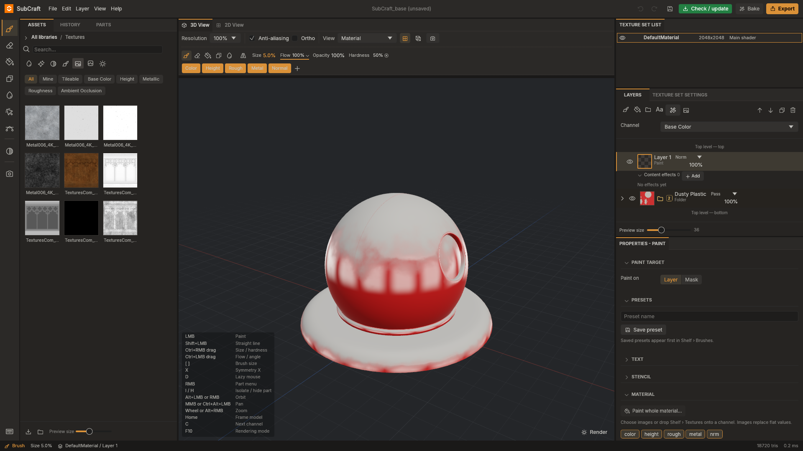
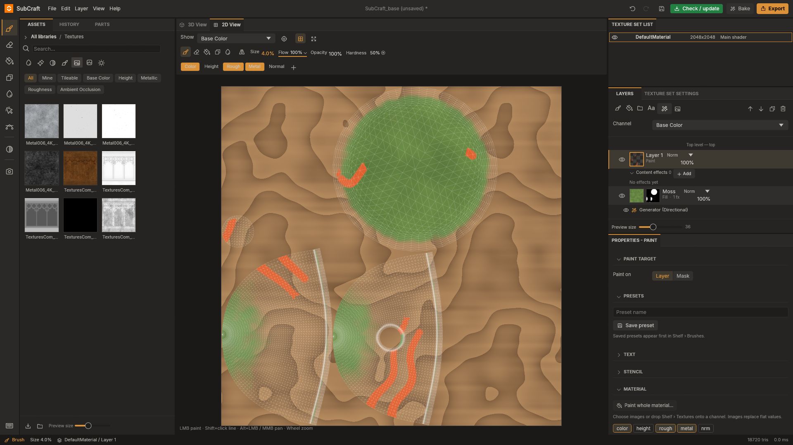

<p align="center"></p>

# SubCraft

[](https://github.com/Aalzard/subcraft/releases/latest)
[](https://github.com/Aalzard/subcraft/releases/latest)
[](https://github.com/Aalzard/subcraft/releases/latest)
[](https://www.paypal.com/donate/?hosted_button_id=UFCVX9QYCB8F8)

**A free, open-source 3D texture painting app in the spirit of Substance Painter, written in Rust.**
Paint on 3D models with layered PBR materials, masks, generators and smart materials, bake mesh maps
and export game-ready textures. Windows and Linux, with experimental macOS and Arm builds.



> **Status: usable, still young.** Painting, layers, baking, smart materials, save / load and export work
> and are covered by tests. Expect rough edges, and the project format may still change.
> What is done and what comes next: [`docs/progress.md`](docs/progress.md). Release notes: [CHANGELOG.md](CHANGELOG.md).
> SubCraft is an independent project, not affiliated with or endorsed by Adobe or ArtCraft.

New here? Read the [getting-started guide](docs/getting-started.md). The app opens on the bundled
**SubCraft_base** model with a 2048 x 2048 texture set, so you can paint right away, and a short in-app
guide walks you through the basics.

## New in 0.5.0

- **Edge wear rebuilt the Painter way**: a continuous edge line at any Wear level that breaks up into
  chipped paint and grows from the edges, up to most of the model at full Wear and Spread.
- **Use Micro Details**: Dirt, Edge wear, Ambient Occlusion, Concave and Curvature generators also react
  to the normal and height of the layers below, so wear follows painted and material relief.
- **Much lower memory use** on big multi-set projects (an 11-set test project went from 6.0 GB to 1.4 GB
  peak), and no more desktop stutter while SubCraft sits idle.
- **Faster**: exports about 3.6x faster, layer edits in heavy stacks up to 3x faster, with identical pixels.
- **Eyedropper** returns to your brush after one pick and samples every channel the brush paints.
- **Reset to default everywhere**: Ctrl+click a setting, or right-click its name, to put its default back.
  A dot marks the settings you changed, in brushes, layers, generators, filters, Bake, Preferences and more.
- Less load on the GPU and processor while SubCraft works or sits idle.
- Fixes for UDIM paint-across and brush preset validation.

**Coming next (not in 0.5.0):** the viewport will shade clear coat, sheen, anisotropy, subsurface,
translucency and transmission, plus a displacement preview. It is waiting for testing on real GPUs.

## Features

### Painting
- Brush, eraser, clone, smudge, stencils, polygon fill, projection tool and editable **pen paths**
  (Bezier, snapping, ribbon and stitch brushes).
- Symmetry (mirror and radial), lazy mouse, jitter, tablet pressure, brush tips and saveable presets.
- Paint in the 3D view or straight into the 2D UV view, across UDIM tiles as one surface.
- Normal / height stamps from the shelf, and per-channel brush blending.

### Layers, masks and generators
- Paint layers, fill layers (uniform, procedural, image, mesh-map), folders, 32 blend modes, anchors.
- Masks with stacked effects. **Generators**: Edge wear, Dirt, Cavity, Curvature, Ambient Occlusion,
  Directional, Position gradient, Cracks, Streaks, Scratches, 3D gradients and more.
- **Filters** such as Blur, Sharpen, Highpass, Bevel, Levels, HSL, Gradient Map, Warp, Kuwahara and Quantize.
- Fill or mask by part, UV island, object or ID colour; **I** isolates, **H** hides.

### Materials and shelf
- Smart materials and smart masks, the downloadable **SubCraft Materials** pack, and `.scsmart` import / export.
- Your own textures (PNG, JPG, TGA, TIF, EXR...) with UV, tri-planar or planar projection.
- CC0 starter pack of normal maps, brush alphas, grunges and 10 HDRI environments.

### Baking
- Normal (from a high poly, with cage), world normal, Ambient Occlusion, Curvature, Thickness, Position,
  ID, Height and Bent Normal, in the background with live results.
- A Bake window that aligns the high poly to the low poly (offset, scale, rotate, auto-fit).

### GPU
- **GPU layer compositing** for 2048 and larger texture sets, with automatic processor fallback.
- **GPU baking**: AO, Curvature and Thickness at 4096 in about 7-11 s instead of minutes.
- Choose the graphics card and API (DirectX 12, Vulkan, OpenGL) in Preferences > Graphics.
- Direct3D 12 on Windows, Vulkan on Linux, Metal on macOS.

### Viewport and rendering
- Real-time PBR viewport with studio presets or HDRI lighting, tone mapping, bloom, AO, depth of field,
  glow, colour LUTs. Display only: exports are never changed.
- **Rendering mode** (F10): a path-traced preview in the 3D view.
- **Render image** (up to 4096 px) and **Turntable** (PNG frames plus a looping GIF).

### Interface
- **Three themes**: Dark, Light and a neutral grey **Substance Painter-style** theme (Settings > General,
  or `--theme dark|light|painter`).
- Painter-style layout, a pen workspace layout, and Painter or Blender 3D navigation.
- **Substance Painter shortcuts** preset; Help > Keyboard shortcuts lists the Painter equivalent of each.
- English, Korean (한국어) and Traditional Chinese (繁體中文).

### Import, export and automation
- Import OBJ, glTF / GLB, FBX, USD, Alembic, PLY and STL. **Open Substance Painter `.spp` projects**
  and rebuild their layer stacks; read `.sbsar`.
- Export presets for Unreal (ORM), Unity HDRP / URP, Godot 4, glTF, Roblox and Sketchfab, plus scene export.
- Project templates, autosave and crash recovery, in-app updates, Help > Report a bug.
- `subcraft-mcp`: a headless [MCP](https://modelcontextprotocol.io) server so AI agents can texture
  models with the same engine ([details](apps/subcraft-mcp/README.md)).



## Performance

Texture data is stored in tiles, so only the tiles you touch are recomposited, saved and uploaded.
On an RTX 4060 at 4096 x 4096, a layer toggle on a 33-layer stack takes about 0.5 s with GPU compositing
(1.8 s on the processor), and a 300 px brush stamp costs about 17 ms. 2048 is the default resolution
(256-4096 available). Details and limits: [`docs/performance.md`](docs/performance.md).

## Install

### Windows

1. Open the [latest release](https://github.com/Aalzard/subcraft/releases/latest) and download
   **`SubCraft-<version>-setup.exe`** under **Assets**.
2. Run it. Windows SmartScreen may say "Windows protected your PC" because the installer isn't
   code-signed yet (free signing through SignPath Foundation is being set up, see the
   [code signing policy](CODE_SIGNING.md)): click **More info → Run anyway**. Each release's notes say
   whether its Windows files are signed.
3. Follow the steps (you can choose "Install for me only" if you don't have admin rights), then
   start SubCraft from the Start Menu. Uninstall it any time from **Settings → Apps**.

Prefer no installer? Download **`SubCraft-<version>-windows-x64.zip`** instead, unzip it and run
`SubCraft.exe`. Either way, any GPU with DirectX 12 works (SubCraft uses Direct3D 12 on Windows; to
try Vulkan instead, set the environment variable `WGPU_BACKEND=vulkan`).

The installer replaces an earlier installed version. Once you have a build with the green
**Check / update** button (v0.1.4 or newer), click it to install future stable releases and
restart with your project restored. Wait until release packages finish uploading if the app
says they are still being prepared.

### Linux

1. Download **`SubCraft-<version>-linux-x86_64.tar.gz`** from the
   [latest release](https://github.com/Aalzard/subcraft/releases/latest) and unpack it:
   `tar -xzf SubCraft-*-linux-x86_64.tar.gz`
2. Run `./install.sh` inside the folder to add SubCraft to your application menu (installs to
   `~/.local`, no root needed; `./install.sh --uninstall` removes it), or just start `./subcraft`.

Needs a Vulkan driver (Mesa or your GPU vendor's) and X11 or Wayland. Built on Ubuntu 22.04, so it
runs on that and newer distributions.

### Verifying a download

Every release file is built by GitHub Actions and has a build provenance attestation. With the
[GitHub CLI](https://cli.github.com/): `gh attestation verify <file> --repo Aalzard/subcraft`.
Checksums are in `SHA256SUMS.txt` on the release page.

**[Code signing policy](CODE_SIGNING.md):** Free code signing provided by SignPath.io, certificate by
SignPath Foundation (pending approval; until then Windows releases are unsigned and say so in their
notes).

### Other platforms (experimental)

| Platform | Package | Status |
|---|---|---|
| Windows x64 | `SubCraft-<version>-setup.exe`, `...-windows-x64.zip` | Supported, in-app updates; code signing via SignPath Foundation pending |
| Linux x86_64 | `SubCraft-<version>-linux-x86_64.tar.gz` | Supported, in-app updates |
| macOS, Apple Silicon and Intel | `SubCraft-<version>-macos-universal-experimental.dmg` (or `.zip`) | Experimental, not notarized, no in-app updates |
| Linux aarch64 (Arm64) | `SubCraft-<version>-linux-aarch64.tar.gz` | Experimental, in-app updates |
| Windows on Arm | `SubCraft-<version>-windows-arm64.zip` | Experimental, in-app updates |

The experimental packages are built automatically by GitHub Actions (`release-platforms.yml`) and
have only been compile-checked by the maintainers so far; please report what works and what does not.

**macOS.** Open the disk image and drag `SubCraft.app` to Applications. The app is not signed with an
Apple Developer ID and not notarized, so the first launch is blocked by Gatekeeper: open **System
Settings → Privacy & Security** and click **Open Anyway**, or run
`xattr -dr com.apple.quarantine /Applications/SubCraft.app`. The build runs natively on Apple Silicon
and Intel (macOS 11 or newer) and uses Metal. Shortcuts use **Cmd** instead of Ctrl. To update, download the
new disk image.

**Linux aarch64** installs like the x86_64 package (`tar -xzf`, then `./install.sh`). It needs a
Vulkan driver for your GPU (Mesa panvk/freedreno/asahi/v3dv or a vendor driver) or, failing that,
OpenGL ES; on machines with only a software rasterizer (llvmpipe) it works but slowly.

**Windows on Arm** unzip and run `SubCraft.exe`. It uses Direct3D 12 and is a native Arm64 build.
There is no installer for Arm yet.

## System requirements

- **Windows** 10 or 11, 64-bit, with a GPU that supports DirectX 12 (Vulkan also works).
- **Linux** x86_64 (built on Ubuntu 22.04, runs on that and newer), a Vulkan driver (Mesa or
  your GPU vendor's) and X11 or Wayland.
- Memory use grows with texture resolution and layer count; no minimum has been measured.

## Build from source

You need a recent stable [Rust toolchain](https://rustup.rs) (1.95 or newer) and a GPU with
Vulkan, Metal or DirectX 12.

```sh
git clone https://github.com/Aalzard/subcraft.git
cd subcraft
cargo run --release
```

Try `cargo run --release -- --demo` for a ready-made layer stack, or pass a model or project file.
On Linux you may need `libxkbcommon-x11-0 libegl1` and a Vulkan driver. Windows setup, packaging and
the macOS / Arm scripts are in [`docs/development.md`](docs/development.md).

SubCraft is a Cargo workspace of small crates with a strict dependency direction
(`core ← image ← mesh / doc ← materials ← compositor / paint / bake ← project / export / assets ← app ← ui ← apps`).
Only the rendering and UI crates know about the GPU or egui. Design decisions are in [`docs/adr`](docs/adr).

## Contributing

Contributions are very welcome: bug reports, feature ideas, docs and code. Please read
[`CONTRIBUTING.md`](CONTRIBUTING.md) first; it explains how to build, test and structure changes.
Everyone taking part is expected to follow the [Code of Conduct](CODE_OF_CONDUCT.md).

## Support SubCraft

SubCraft is free and developed in spare time. If it is useful to you, you can
[support its development with a donation](https://www.paypal.com/donate/?hosted_button_id=UFCVX9QYCB8F8).
Bug reports, ideas and code are just as welcome.

## License

SubCraft is dual-licensed under either of

- [Apache License, Version 2.0](LICENSE-APACHE)
- [MIT License](LICENSE-MIT)

at your option.

Unless you explicitly state otherwise, any contribution intentionally submitted for inclusion in
SubCraft by you, as defined in the Apache-2.0 license, shall be dual licensed as above, without any
additional terms or conditions.

## Credits

- Bundled third-party assets keep their own licenses: the [Inter](https://rsms.me/inter/) font
  (SIL Open Font License 1.1) and [Phosphor Icons](https://phosphoricons.com) (MIT), both in
  `crates/ui/assets/fonts` with their license files.
- The starter pack (110 normal maps, 84 brush alphas) is CC0:
  [credits](assets/starter-pack/CREDITS-CC0.txt). The bundled HDRIs are CC0:
  [credits](assets/environments/CREDITS-CC0.txt). The generators' grunge map is CC0:
  [credits](assets/grunge/CREDITS-CC0.txt).
