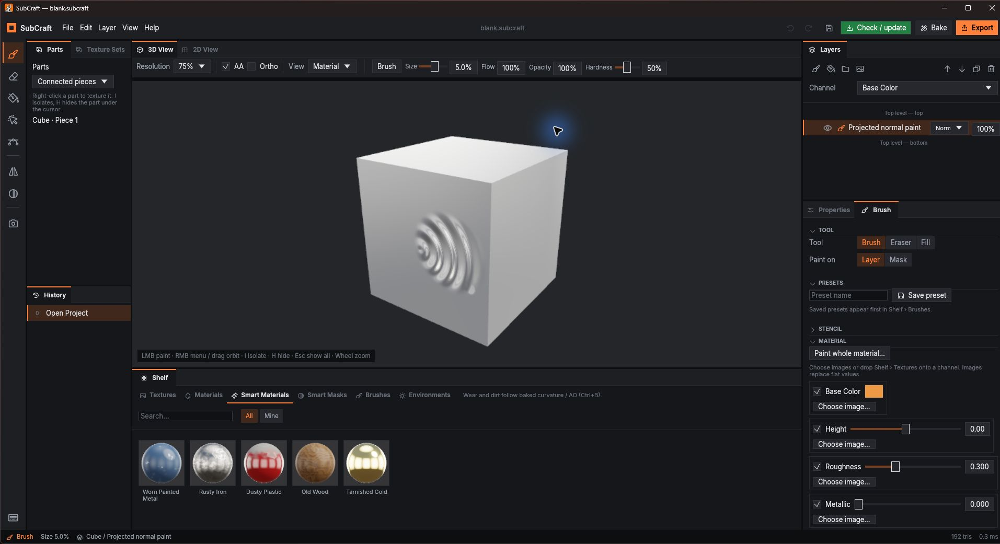
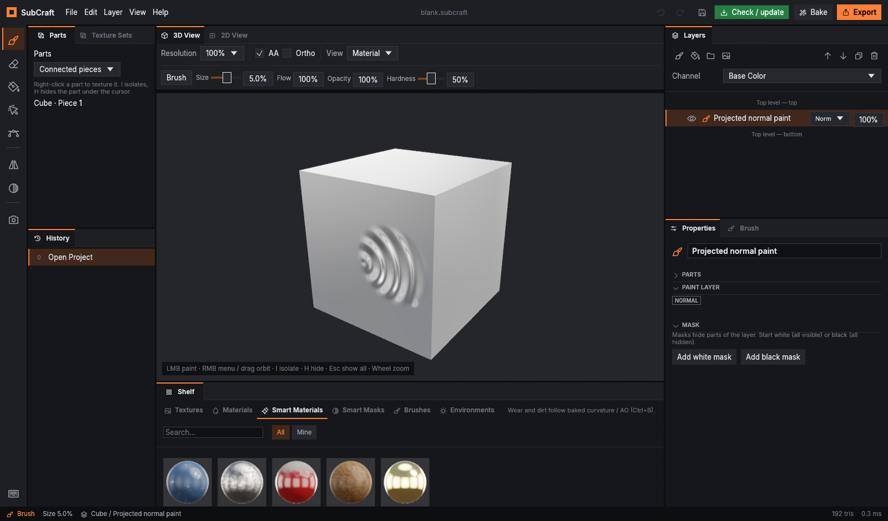
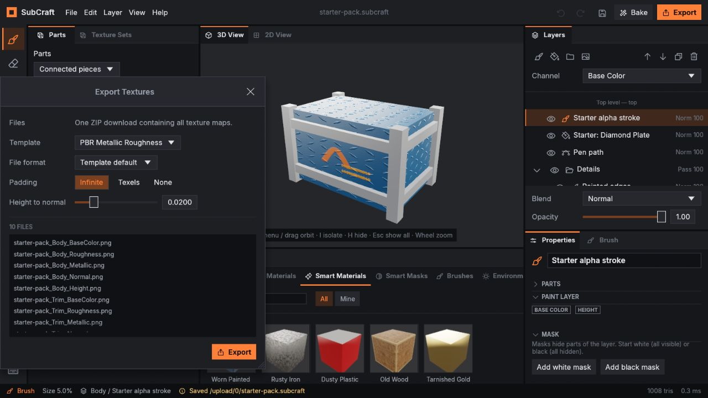

# Getting started with SubCraft

The welcome hub and in-app guide are in development for the next desktop release. In v0.1.4,
use **File → New from mesh…** or **File → New (sample crate)** to follow these steps.

Start with **Try the sample** on the welcome screen, or bring a model with UVs. Open
**Help → Quick start** for the same six steps inside the app. You can move the guide aside
while working, use Back/Next, or close it and reopen it later.

## 1. Open a model

Choose **New from a model…** on the welcome screen or **File → New from mesh…**. Desktop accepts
OBJ, GLB/glTF and FBX. The browser accepts OBJ and GLB/glTF; upload a `.gltf` together with its
`.bin` and any files it needs. A GLB is easier to share because those resources can be embedded.

Your model needs UVs for painting and texture export. Separate material IDs become texture sets;
switch sets in the **Texture Sets** panel. Imported object names appear in **Parts**.

To resume work, use **Open project…** for a `.subcraft` file. Desktop recent files list both
models and projects, and mark moved/deleted files as missing. Remove an entry to tidy the list.
Turn off **Show this screen on startup** here or in **Edit → Preferences** if you prefer.

## 2. Bake mesh maps

Click **Bake** in the top bar (Ctrl+B). Start with curvature and ambient occlusion at 512 pixels;
increase resolution and sample count once the material looks right. Wear and dirt masks use
these maps. A normal bake from a high-poly model also needs a low-poly model with UVs.

Inspect the results in **2D View**, using its map selector. Baking saves the maps in your project.

## 3. Drag a smart material

In **Shelf → Smart Materials**, drag **Worn Painted Metal** onto the model or a layer. Click a
layer in its folder and adjust its fill or generator in **Properties**. Undo with Ctrl+Z to try
another material. Each texture set has its own layer stack.

## 4. Paint and use Parts

Add/select a paint layer and use **Brush** (B) to paint with the left mouse button. Right-click
the piece under the cursor for **Fill**, **Paint only here**, layer masks and generator masks.
Switch the part type in **Parts** to work with connected pieces, UV islands, objects or material
IDs. Part-limited painting prevents brush writes outside that selection.

Hover a piece and press **I** to isolate it or **H** to hide it. **Esc** restores visibility;
hiding pieces changes the view, while your saved model and exported textures keep all parts.
Right-drag orbits, the wheel zooms, and **Home** resets the camera.

### Paint a normal map or material onto a paint layer

The essential brush settings are now **above the 3D View**, beside Resolution, **AA**
(anti-aliasing), **Ortho** (orthographic) and the material/channel display. A thin divider
separates the brush controls. Use the short **Size** and **Hardness** sliders, or drag their
number fields. **Flow** and **Opacity** are compact percentage boxes: drag left/right to adjust,
or double-click to type a value. Size is a percentage of the model's diagonal; the other three
show 0–100%. The **Brush** menu switches between Brush, Eraser and Fill.

In narrower docks the brush controls move to a second top row, then switch to number fields.
In tiny docks, open the **Brush/Eraser/Fill** menu for all four settings; **View** holds the
viewport options. Advanced settings, channel images and presets remain in the Brush panel.
Changes from the bar, existing size shortcuts and presets use the same brush state.

Select an ordinary **paint layer**, choose **Brush (B)**, and set **Paint on → Layer** in the
Brush panel. In **Material**, use the channel's **Choose image…** (or **Replace…**) button.
For a normal-only stroke, uncheck the other channels. **Clear image** restores that channel's
flat value; its enable checkbox still decides whether it paints. Normal maps use OpenGL (+Y);
files named `normalDX` / `normal_dx` are converted automatically when assigned to Normal.

Use **Paint whole material…** to select several named maps together, such as `Metal_basecolor`,
`Metal_roughness`, `Metal_metallic`, `Metal_normalDX`, `Metal_height`. This loads the brush and
enables only those channels. It creates no layer. Missing texture-set channels are skipped and
reported; packed ORM/ARM imports remain unsupported. Gloss/smoothness maps invert to roughness.
Imported images from **Shelf → Textures** can also be dragged onto a brush channel row. Starter
pack normal drops still target fill layers in this version; use an imported file for a brush.

**Image projection** is independent of brush footprint **Alignment**. UV follows the model UVs;
Planar projects along X/Y/Z; Tri-planar blends the three object-axis projections. Tiling X/Y
(**Link** for equal repeats), Offset, Rotation and Sharpness use the same controls as fills.
Untick **Tile images** to paint only inside the transformed image. Camera/per-stamp image
projection is still planned. Normal map vectors follow the existing fill interpretation;
projection-frame rotation does not yet reorient tangent vectors across mirrored/separate islands.

**Normal blend → Replace** replaces normals under the brush. **Detail** combines the new map
with normals already painted on this same layer. Use the layer's normal blend mode to combine
with lower layers. Both stroke modes normalize their result. Size, flow, opacity, alpha tips,
stencils, symmetry and Parts restrictions continue to apply; the entire drag is one undo step.

**Presets → Save preset** stores the images, projection, tiling and normal blend along with the
existing brush settings. The preset carries its image bytes and works in another document after
the original files are removed. Projects save the painted pixels; load the brush preset to
restore its tool setup. There are no new keyboard shortcuts in this slice.

## 5. Save your project

Use **File → Save** (Ctrl+S) to save a `.subcraft` file containing the model, layers, imported
images and baked maps. Desktop saves to the chosen location. The browser downloads the project;
keep that download so you can reopen it next time.

Desktop autosave creates recovery copies in SubCraft's data folder. It does not overwrite your
project file. Save your own project regularly; in the browser, download a backup when prompted.

## 6. Export textures

Click **Export** (Ctrl+Shift+E). Choose PBR metal/rough, Unreal, Unity HDRP or glTF to match your
target application. Desktop writes to your chosen folder. The browser downloads one ZIP with
all texture maps; extract it into a folder before using them in your engine.

The Unreal template packs ORM and uses DirectX normals; PBR/glTF use OpenGL normals. Choose the
right template before judging the result under lighting.

## Editable pen paths

Select **Pen (P)**. Click on the model or in **2D View** to add an anchor; drag while adding it
to create Bézier handles. Drag existing anchors/handles to edit, or hold **Shift** to move one
handle separately. **Enter** finishes adding points, **Esc** cancels the current edit and
**Delete** removes the selected point. Each released gesture is undoable; parameters stay
editable after saving and reopening.

In **Properties → Editable pen path**, use **New path**, **Corner/Smooth**, **Closed path**, width,
hardness, opacity and channel values. Width is measured in UV space. Use 2D View for handles
outside UV islands; use separate paths across seams. Overlapping UVs share texture painting.
Middle/Alt drag pans; the wheel zooms. Pen uses round strokes; alpha tips and symmetry remain
brush tools. Save/Export waits for any path still being drawn.

Projects saved with the Pen tool use schema 4 and need SubCraft v0.1.5 or newer to reopen.
Earlier projects still open.

## Starter textures and alpha tips

In **Shelf → Textures → Starter pack**, drag a normal map onto a fill layer's **Normal** row,
or onto the model/layer list to add a normal-only fill layer. **Tileable** filters the tagged
maps. In **Shelf → Brushes → Starter pack**, click an alpha to preview it, then **Use as brush
tip**. Built-in tips and imported images remain available in All/Mine.

Click a texture to open its preview. Choose **1×1 / 2×2 / 3×3** to inspect seams. Normals have a
strength slider, a lit sphere, green flip for OpenGL/DirectX and bump inversion. Alphas have
brightness/contrast, invert and a sample stroke. Both offer scale, rotation, wrap mode and
**Make seamless** edge blending. Inspect the repeated result; blending softens boundary details.
**Add adjusted fill layer** bakes the adjustments into a new image copy. The original files stay
unchanged, and normal-map resources travel inside saved projects. Width/height are 1024px for
all pack images. Full images load only when selected; desktop needs no network connection.

The images are [CC0](../assets/starter-pack/CREDITS-CC0.txt), including for commercial use.

For more detail, see the [README](../README.md), [changelog](../CHANGELOG.md) and
[development notes](development.md).
