# Getting started with SubCraft

For future signed downloads, check the publisher in Windows file **Properties → Digital
Signatures** and compare the file's SHA-256 against the release's **SHA256SUMS.txt**
using PowerShell: `Get-FileHash -Algorithm SHA256 <downloaded-file>`.
Original v0.1.7 is unsigned. Signing/provenance infrastructure is prepared for future
releases and does not retroactively sign it; see [release verification](release-security.md).

For the latest local development build, open **target/debug/subcraft.exe** in the SubCraft
folder. This contains the current material-workflow and charcoal UI refinements; installed
releases and older release binaries may have fewer features.

Imported PBR materials now use automatic distance filtering in the 3D viewport, so fine
wood grain and normal/height details stay clearer when zoomed out. No extra control is
required. In **Texture Sets → Albedo**, use **Bilinear** for this smooth preview; **Nearest**
keeps sharp source pixels for retro texturing. Source maps and exported textures keep their
existing resolution and data. The viewport's **Anti-aliasing** checkbox separately controls
mesh-edge smoothing.

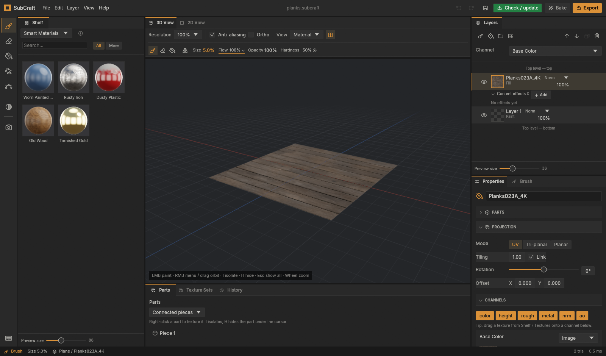

The welcome hub and in-app guide are in development for the next desktop release. In v0.1.4,
use **File → New from mesh…** or **File → New (sample crate)** to follow these steps.

Start with **Try the sample** on the welcome screen, or bring a model with UVs. Open
**Help → Quick start** for the same six steps inside the app. You can move the guide aside
while working, use Back/Next, or close it and reopen it later.

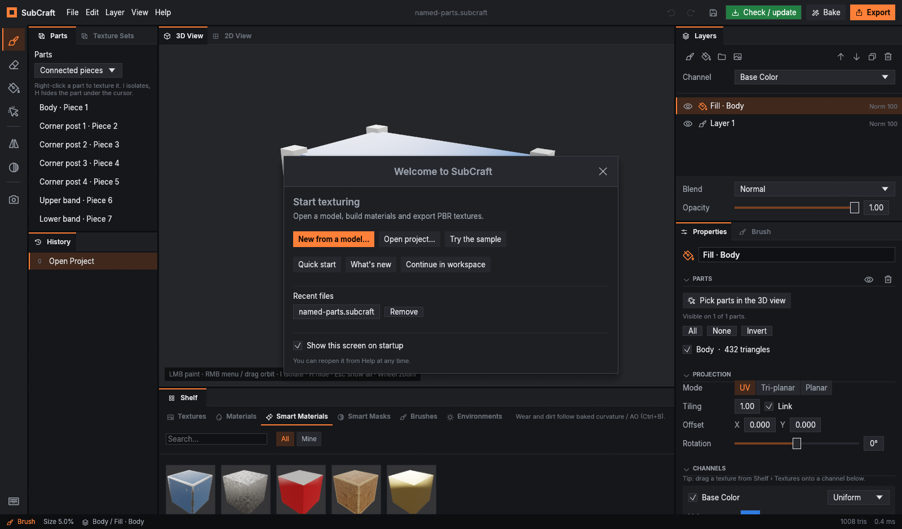

Open **File → Preferences…** (also available from Edit). **UI size** is the first setting:
drag its slider or type a percentage to scale text, icons and controls together, from **75% to
150%**. The default is a slightly smaller **95%**; **Reset** restores it. Changes apply live
and are saved between runs. This is independent of the 3D view's render Resolution setting.
Preferences scrolls when a large UI or small window needs more room.

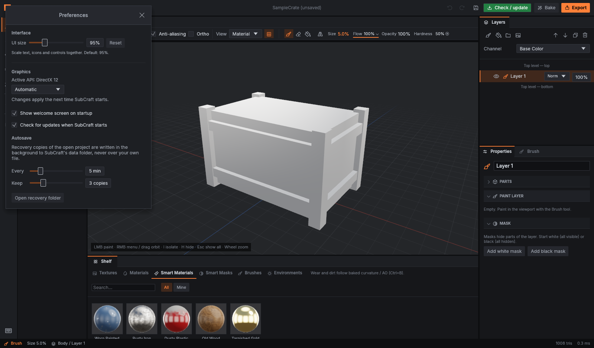

The workspace uses neutral charcoal panels, warm gray text and a restrained amber accent.
Thin sliders have round handles; drag the handle or click/type in its numeric value as before.
Layer content and masks have larger, separate square previews. Click either preview to edit
that target. The second line identifies the layer type and total effect count; blend mode
and draggable opacity sit in the right column. Hover for channel/domain details.

Under the selected layer, **Mask effects** or **Content effects** shows the chosen target's
stack. Shorter rows and connecting lines distinguish effects from their parent. Click the
header/caret to fold or unfold this stack; folding does not disable effects or change the
selected editing target. **Add** and effect right-click actions work as before. Layers,
Parts and History retain alternating row shades, a brighter hover and an amber selection edge.

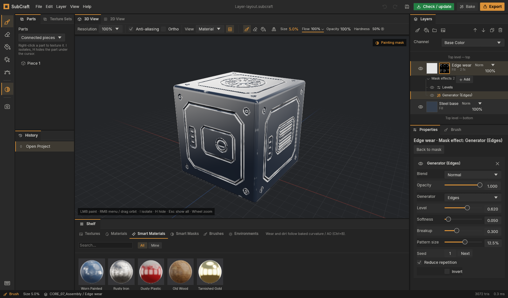

**Shelf previews:** assets wrap into rows inside the panel. Scroll vertically to browse the
rest. Narrow shelves use a category dropdown instead of a clipped tab strip; the small info
icon shows the category's workflow hint. The **Preview size** slider beneath the assets
changes thumbnail size (48–160 points) and stays visible while the assets scroll. Long names
are shortened to one line; hover an asset for its details.

**Layer previews:** use the separate **Preview size** slider at the bottom of Layers
(24–64 points). Both content and mask previews resize together, and the layer rows adapt.
Narrow panels cap their displayed size to keep names and blend controls visible. This leaves
effect rows compact. Both sliders are remembered independently between runs; they change
display size only, without affecting material resolution, masks, paint or undo history.

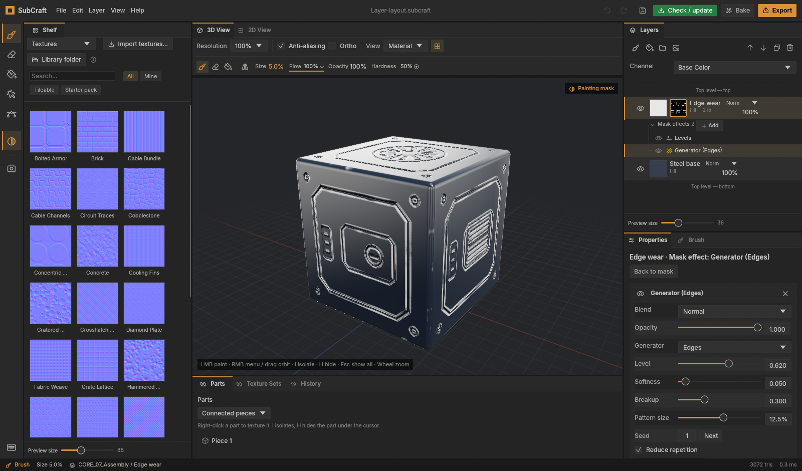

The normal workspace now places **Shelf on the left**, with **Parts / Texture Sets / History**
as tabs beneath the center viewport. **View → Reset layout** restores this arrangement.
This update applies the arrangement once; later dock changes are remembered.

When **Texture Sets** is wide, its set list, Resolution/Albedo controls and bake/mesh status
sit beside one another so you can use a shallow bottom panel without scrolling through all
the settings. Click a set, change Resolution or Albedo, or click **Bake…** as usual. Hover the
Resolution heading for its explanation. A long set list can scroll in its own column.
If you dock the panel in a narrow sidebar, the same controls switch back to a vertical layout.

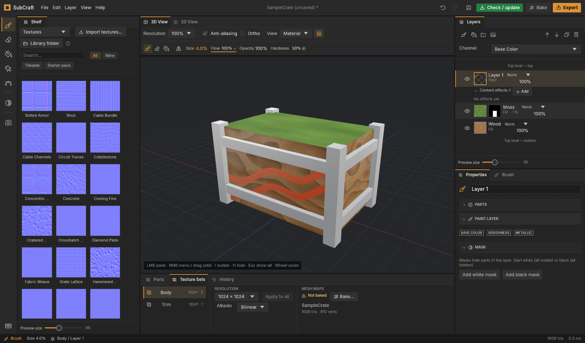

## 1. Open a model

Choose **New project from a model…** on the welcome screen or in the **File** menu and pick an
OBJ, GLB/glTF or FBX file (a `.gltf` needs its `.bin` and other files next to it; a GLB embeds them).
The **New Project** window opens before anything is created:

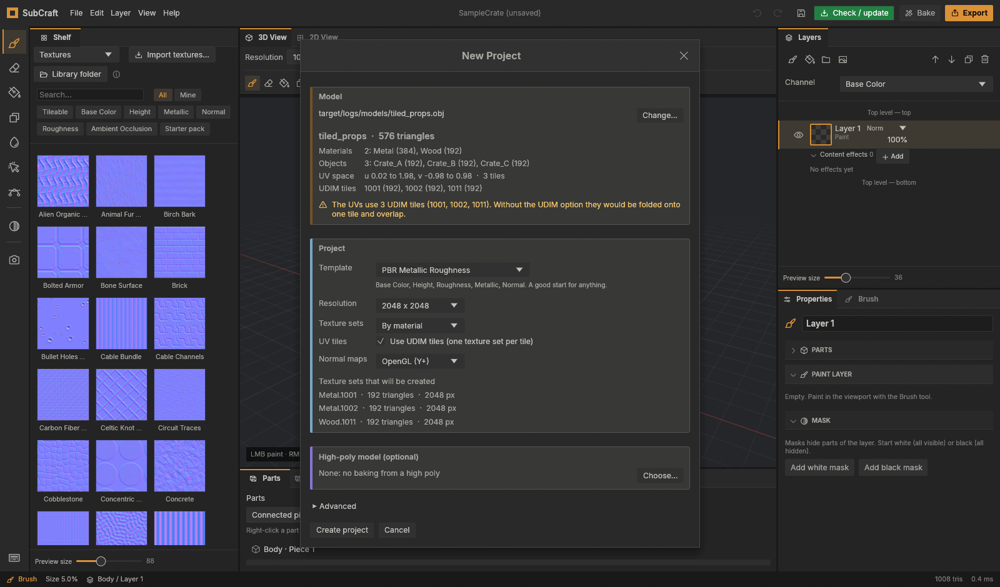

- **Model** shows triangles, materials, objects, the UV range and any UDIM tiles, with warnings
  (no UVs, overlapping UVs, triangles crossing a tile border).
- **Template** chooses which channels exist (PBR, Unreal ORM, Unity, Godot, Stylized) and the
  default normal format; **Resolution** applies to every set (per-set sizes are under Advanced).
- **Texture sets** splits the model by material, by object or into one set.
- **Use UDIM tiles** (shown when the model has two or more tiles) makes one texture set per tile.
- **Normal maps**: OpenGL (Y+) or DirectX (Y-); this is applied when you export.
- **High-poly model** is optional; choosing one opens the Bake window with it afterwards.

Your last choices are remembered. Press **Create project** (or Enter).

Your model needs UVs for painting and texture export. Switch texture sets in the **Texture Sets**
panel; imported object names appear in **Parts**.

To resume work, use **Open project…** for a `.subcraft` file. Recent files list both models and
projects, and mark moved/deleted files as missing. Remove an entry to tidy the list.
Turn off **Show this screen on startup** here or in **Edit → Preferences** if you prefer.

## 2. Bake mesh maps

Click **Bake** in the top bar (Ctrl+B). Start with curvature and ambient occlusion at 512 pixels;
increase resolution and sample count once the material looks right. Wear and dirt masks use
these maps. A normal bake from a high-poly model also needs a low-poly model with UVs.

Inspect the results in **2D View**, using its map selector. Baking saves the maps in your project.

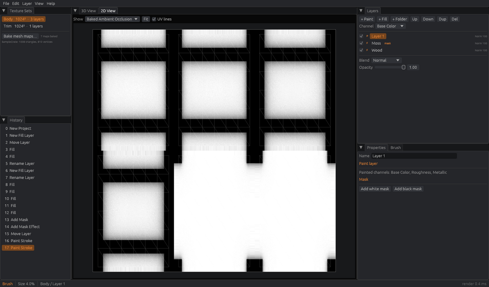

## 3. Drag a smart material

In **Shelf → Smart Materials**, drag **Worn Painted Metal** onto the model or a layer. Click a
layer in its folder and adjust its fill or generator in **Properties**. Undo with Ctrl+Z to try
another material. Each texture set has its own layer stack.

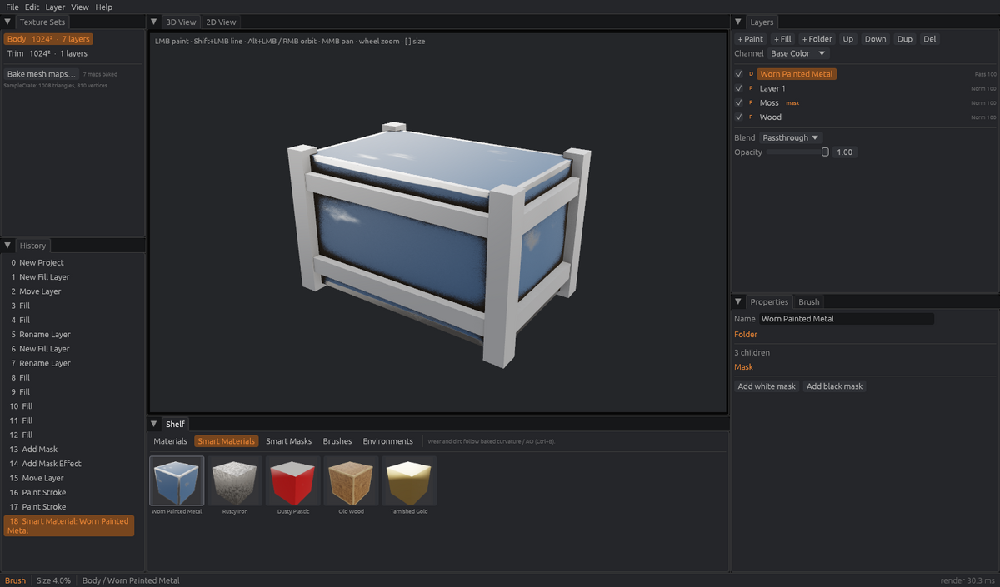

## 4. Paint and use Parts

Add/select a paint layer and use **Brush** (B) to paint with the left mouse button. Right-click
the piece under the cursor for **Fill**, **Paint only here**, layer masks and generator masks.
Switch the part type in **Parts** to work with connected pieces, UV islands, objects or material
IDs. Part-limited painting prevents brush writes outside that selection.

Hover a piece and press **I** to isolate it or **H** to hide it. **Esc** restores visibility;
hiding pieces changes the view, while your saved model and exported textures keep all parts.
Right-drag orbits, the wheel zooms, and **Home** resets the camera.

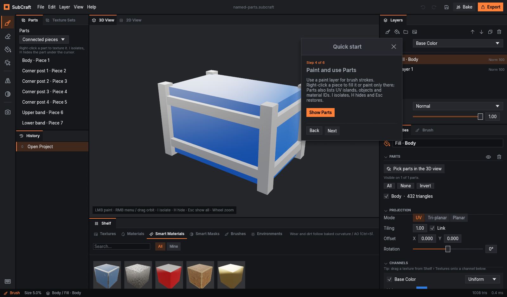

### Paint a normal map or material onto a paint layer

The essential brush settings are **above the 3D View**, beside Resolution, **Anti-aliasing**,
**Ortho** (orthographic) and the material/channel display. A thin divider separates the brush
controls. Click the small **brush**, **eraser** or **paint bucket** icon to select a tool;
the active icon is orange, matching the left tool rail.

**Size** has a plain orange number: drag it left/right to adjust, or click to type and press
Enter. **Opacity** works the same way with a neutral percentage. Hold **Shift** during a
number drag for finer control. Size is a percentage of the model's diagonal; the other three
settings show 0–100%. **Flow** has a thin amount indicator: click its label/value to open a
slider. **Hardness** has a small dot indicator and opens its own slider. Both popovers also
allow numeric entry; click outside or press **Esc** to close. Flow is paint per stamp, while
Opacity caps the complete stroke. Fill uses Opacity and disables brush-specific settings.

In narrower docks the brush controls move to a second top row. In tiny docks, open the
**sliders icon** beside the tool icons for all four settings; **View** holds the
viewport options. Advanced settings, channel images and presets remain in the Brush panel.
Changes from the bar, existing size shortcuts and presets use the same brush state.
The default layout gives more width to the 3D canvas; your saved dock arrangement is preserved.
Use **View → Reset layout** to adopt the wider default, or drag the dock dividers to suit your screen.

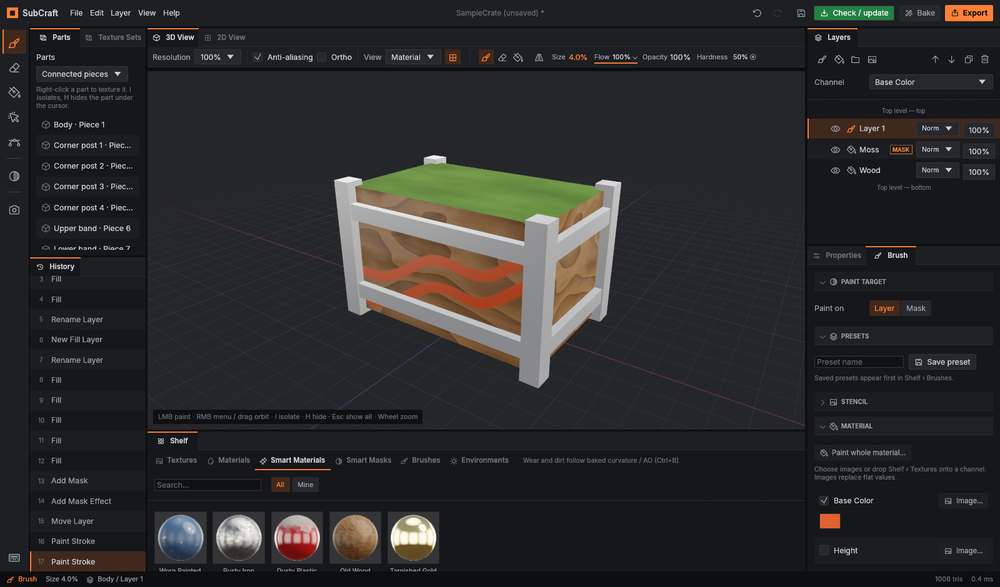

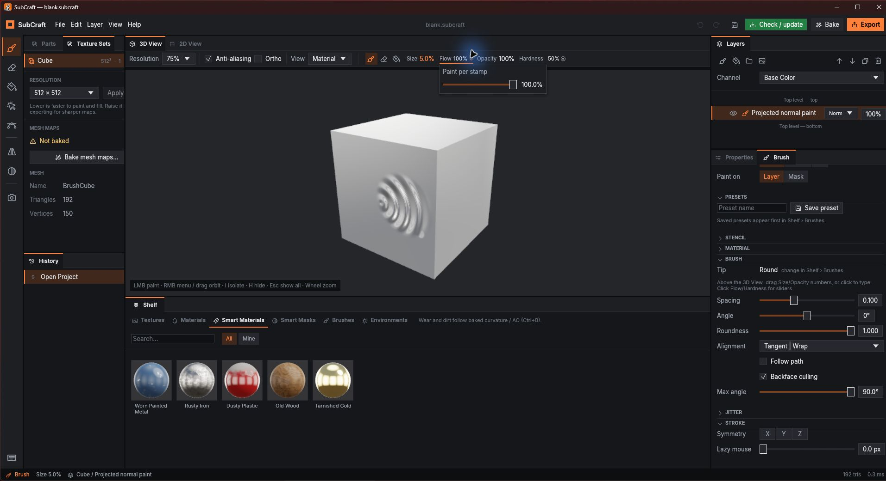

Parts, History and Layers use alternating dark/lighter charcoal rows and more vertical space.
The shading has been strengthened so adjacent rows are easier to distinguish. Hover brightens
either shade; the current history step and selected layer keep their orange highlight. Hidden Parts use a
crossed-eye icon; right-click any part row for the existing actions. Brush and Properties use
banded section headers with icons: click a header/caret to expand it. The property rows inside
also alternate gently. Existing controls, context menus and shortcuts behave the same way.

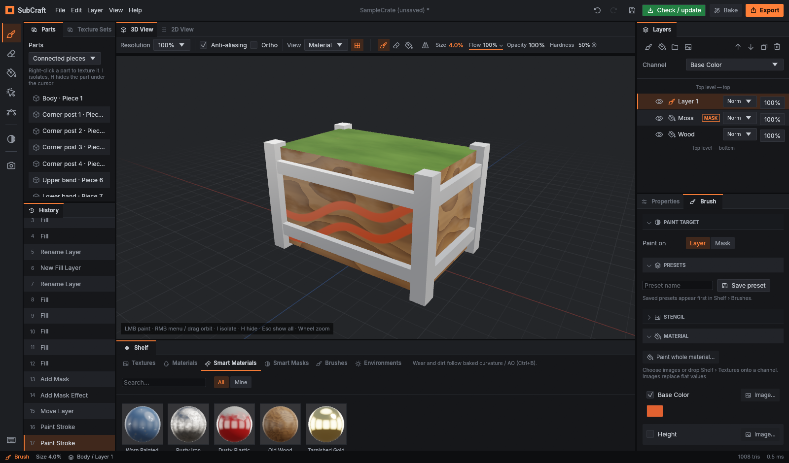

Select a **fill layer** in Layers to open its **Properties** automatically: Projection, Channels,
images, values and masks edit that selected fill. Selecting an ordinary **paint layer** reveals
the **Brush** settings again. Folders and editable pen paths open their own Properties too.
You can still click Properties for a paint layer's masks/parts, or Brush to paint a fill layer's
mask. Your explicit tab choice stays until the layer selection changes. Brush Material controls
set the painting tool's material; fill-layer material controls live in Properties.

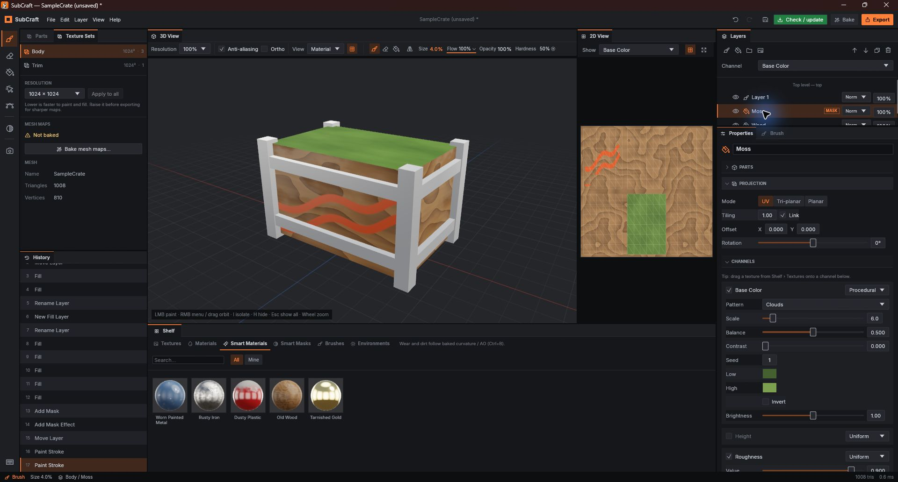

### Layer content and mask thumbnails

Layer rows now show a square **content thumbnail** in place of the generic material icon.
It previews the channel chosen above Layers (Base Color, Roughness, Normal, etc.) in UV space,
before that layer's own mask, opacity or visibility. Empty paint content shows a checkerboard.
A layer with a mask has a second, grayscale square beside it. The orange outline identifies
the selected square; thumbnails update after painting, material changes and procedural edits.

Click the content square to edit the layer's material/painting tool. Click the mask square
to open its **Mask Properties** and make the brush paint its grayscale base instead of the
material. **Paint value** controls white/reveal versus black/hide. Other brush controls stay
in the top toolbar. This works for paint layers, fill layers and folders.

Right-click a layer row → **Add mask → White mask / Black mask**. White starts fully visible;
black starts hidden. The new mask is selected automatically. Right-click the mask thumbnail
for Preview, Enable/Disable, Invert, Copy, Paste and Remove; the Mask Properties panel also
has these actions. **Shift+click** a mask thumbnail toggles its effect on the layer; a diagonal
mark shows when it is disabled. The thumbnail continues to show the authored mask.

**Alt+click** its thumbnail, or press **Preview**, to open a grayscale UV preview. Thumbnails
use reduced 64px previews and this window uses 256px; very fine texture marks may disappear
at these preview sizes. The model/export retain full-resolution data. Full-resolution isolated
2D/3D mask display is still planned.

**Invert** adds an editable inversion effect; it does not destroy original painting or
generators. **Copy/Paste** copies the whole mask/effect setup inside the current project
session, resamples painted data to the target texture-set resolution and gives effects fresh
IDs. Copy is not an undo step; Paste, Invert, Disable and Remove are undoable. The clipboard
does not cross project sessions. Cross-resolution paste uses the existing image resampler
and can take longer on large painted masks.

Mask Properties lists the existing effects with move up/down, Duplicate, visibility, Remove,
blend and opacity controls. Fill supports a uniform value or procedural pattern and projection;
Generators expose their type/threshold/softness/breakup and direction; Levels has input/output
ranges and gamma. Effects evaluate from bottom to top.

Generator **Pattern size** controls breakup feature size as a percentage of the model's longest
dimension: larger values make larger patches. **Seed** changes the variation; **Next** tries
the next reproducible seed. **Reduce repetition** uses continuous object-space volume noise,
so opposite faces do not reuse the same projected tile. It stays continuous across UV seams.
Overlapping or mirrored UVs still share texels; unique wear on those parts requires unique UVs.
New Edges and Dirt/Cavity generators start with **0.3 Breakup** and Reduce repetition on; the
Edge Wear smart-mask recipe keeps its authored 0.35. Existing saved generators keep their
appearance until you opt into the new pattern or natural-wear mode. You can still lower breakup manually.

If Edge Wear has small gaps at hard corners, open **Bake mesh maps**, select **Curvature** and
rebake with the current build. The corrected baker keeps exact corner and UV-border samples
connected, including the default crate's body beside its posts with **Natural edge wear off**.
Nearby separate parts cannot cancel a surface's own corner curvature; flat surfaces still
receive contact curvature. Opening an old project retains its stored bake until you rebake. Set **Breakup** to
0 temporarily to distinguish curvature coverage from intentional wear variation.

For organic wear around the default crate's posts/bands, select the **Edges** mask effect and
enable **Natural edge wear**. New Edges generators enable it automatically. Older saved masks
keep their original evaluator until you turn this on. **Spread** grows wear outward along
connected geometric creases, in percent of model size, independently of **Level**. For example,
**Level 0.065 / Spread 12.5%** now has the full selected reach. Level selects the baked convex
detail contribution in Natural mode; it no longer shrinks the geometric spread radius.
**Variation** makes the boundary irregular even at **Breakup 0**. Set Variation to 0 for a
clean band; raise Breakup to remove patches. Pattern size and Seed change the shared pattern.
These controls are undoable and saved with projects and smart masks/materials (schema 8).
Existing natural masks with Level other than 0.5 change width after this correction; settings
are retained, so reduce Spread if you want their earlier narrower result.
Separate crate components cannot erase each other's geometric edge source. Spread is exact on
convex flat faces and conservative across curved/non-convex surfaces. Baked rounded/high-poly
detail still contributes, but expanding baked-only or painted-normal details needs further work.

At the top of **Channels**, click a channel button to toggle it independently. **Alt+click**
enables only that channel. Disabled settings rows disappear and their values/images are kept
for re-enabling. Fill layers and Fill effects apply the whole solo action in one undo step.
Brush buttons choose channels for future strokes; they do not hide existing paint on a layer.
Projection **Rotation** sits directly below **Tiling**, and changes orientation independently
of scale. These controls are shared by the supported texture projections.

### Content and mask effects

**Filters:** click a layer's content square, then **+ Add → Filter** beneath its row. Choose
**Contrast**, **HSL**, **Threshold**, **Clamp**, **Blur**, **Sharpen**, **Directional Blur**,
**Highpass**, **Bevel** or **Mask Outline**. The filter appears as an editable effect;
select it to change its channel and parameters in Properties. Contrast 1 is neutral; Pivot
sets its center. HSL changes hue in degrees, saturation (1 is neutral) and lightness (0 is
neutral). Threshold creates black/white from luminance or a scalar channel. Clamp limits
values between Minimum and Maximum without rescaling them. Normal vectors are excluded.

For masks, click the grayscale square and use **+ Add → Filter**. Contrast, Threshold, Clamp,
Blur, Sharpen, Directional Blur, Highpass, Bevel and Mask Outline process the mask below them. HSL is available
on color content only. Eye, blend,
opacity, Move up/down, Duplicate and Delete retain their existing behavior. Order matters:
a Threshold after a generator changes its result; one below it changes an earlier stage.
Original paint stays intact, and Undo restores the previous settings.

For an adjustment affecting the stack beneath it, create a **Folder**, leave its channel
blend at **Passthrough**, and add a content Filter or Levels effect. An empty passthrough
folder works as an adjustment group; its mask and opacity limit the adjustment. Set the
folder's channel blend to **Normal** to filter only its children's combined content.
Folders currently accept adjustment effects; paint/fill source effects belong on their layers.

**Blur** softens values and painted coverage. **Radius** is measured in working texture pixels
(0-32); zero restores the unfiltered result. **Sharpen** uses the same Radius with **Amount**
(0-4) to bring out detail while keeping original paint coverage. Start with a small radius and
amount. Add either to a mask to soften or strengthen its existing pattern. Move the effect
above/below a Threshold to change whether the thresholded edge or its source is softened.
Existing eye, blend, opacity, duplicate, removal and Undo controls apply. Layer/mask thumbnails
and enlarged previews account for their smaller or larger resolution automatically.

**Directional Blur** softens along one axis. Set **Radius** (0-32 working pixels) and **Angle**
(-180 to 180 degrees). 0 is horizontal, 90 vertical, 45 slopes down-right and -45 slopes up-right
in the UV image. The axis repeats every 180 degrees. It softens paint coverage without dark
fringes; zero radius leaves the input unchanged with Normal effect blending. Try it above a mask or
procedural pattern for directional streaking.

**Highpass** removes broad changes and keeps detail. **Radius** selects the detail scale;
**Amount** controls contrast (0-4). Normal effect blending shows detail around 0.5 gray for
color/scalar channels and masks, or zero for signed Height. To retain original color, use the
effect's **Overlay** blend; for Height use **Signed Addition**. Highpass preserves painted
coverage. Radius zero or Amount zero gives the neutral detail field, not the original texture;
hide/remove the effect to bypass it. Existing opacity, order, duplicate and Undo controls apply.

**Bevel** turns a thresholded shape into an inward relief ramp. For raised detail, put a
black/white texture or Paint/Fill effect in **Height**, then add **Filter > Bevel** on Height.
**Threshold** defines the shape, **Radius** (0-32 working pixels) sets the bevel width, and
**Amount** sets the plateau height. Start with a small Amount (for example 0.025); negative
Height Amount makes recessed detail. Outside the shape is zero. Radius zero gives a hard
plateau. On a mask, Bevel produces a grayscale ramp for a softened inset boundary.

**Mask Outline** creates a border around a painted or procedural shape. Select a fill layer's
mask square, add Paint/Fill/Generator for the source shape, then **+ Add > Filter > Mask Outline**.
Set **Threshold**, **Radius**, and **Position: Inner / Outer / Both**. Radius is width on each
chosen side; Both extends by that width in both directions. Radius zero clears the border.
Use the existing effect eye to bypass it, or blend/opacity to combine it with the original.
The border has a small antialias transition and follows raster corners across internal tiles.

Both filters produce grayscale from luminance or scalar values. Content coverage stays intact;
use the filter on a mask to reveal fill material beyond a shape's original painted area.
An entirely white mask has no contour: Bevel reaches its plateau, Outline is empty. Changing
Radius changes width independently of Threshold. Thumbnails scale pixel widths automatically.
No new shortcut is required; existing Undo, duplicate, reorder and save controls apply.

These are UV texture filters: they cross internal tile boundaries, clamp at the outside of the
texture, and can mix neighboring UV islands. They do not follow a surface across UV seams.
Increasing texture-set resolution makes a fixed pixel radius look smaller; adjust Radius if
needed. Normal vectors are excluded. Sharpen/Highpass preserve signed Height and bound other values
to 0-1. Projects and Smart Materials/Masks save filters using schema 12; older projects still
open. Bevel Smooth, Height Adjust and other filter operations remain planned.

Every paint or fill layer has two separate effect stacks: one on its **content** and one on its
**mask**. Select a layer and its stack appears right under its row. Which stack you see follows
the thumbnail you clicked: the content square shows **Content effects**, the mask square shows
**Mask effects**. Effects run from the bottom of the list to the top, and never change the
layer's own painting or fill, so you can hide, reorder or delete them at any time.

* **+ Add** (beside the stack's title) adds an effect on top and selects it. Content effects:
  **Paint** (painted detail on top of the content), **Fill** (a material: base color, roughness…
  — enable the channels it should change) and **Levels** (remaps one channel; transparent areas
  stay transparent). Mask effects: Paint, Fill, Generator, Levels and Invert.
* Click an effect row to edit it in **Properties** (name, visibility, settings and per-channel
  blending/opacity). Click it again, or press **Back to layer** / **Back to mask**, to return.
* Each effect now has a small **preview square**. It shows the result through that effect,
  including the steps below it, so you can compare stages. Click the square to select the
  effect and edit its Properties. Filter/Levels squares show their target channel; Paint/Fill
  squares use the Layers channel dropdown. Mask squares stay grayscale.
* Drag **Preview size** beneath Layers to resize layer, mask and effect squares together.
  Effects stay smaller so the stack remains compact. Hidden effects have a diagonal mark and
  show the bypassed result. Collapsing the stack hides its effect previews.
* **Drag an effect name, row or preview square** to reorder it. Drop on the upper/lower half
  of another row to place it above/below; an amber line shows the destination. Hold near the
  list edge to scroll. **Esc** cancels; releasing outside a valid effect row keeps the order.
  Effects reorder within their current layer and content/mask stack. The moved effect stays
  selected in Properties, and one Undo restores the entire move.
* The **eye** on a row hides the effect. **Right-click** a row to move it up or down,
  duplicate or delete it. Every change is one undo step; selecting is not.
* While a **Paint** effect is selected, the brush paints into that effect only — this also
  lets you paint on top of a **fill layer**. The 3D view shows “Painting Paint effect”.
  Erasing removes only that effect's paint. A Paint effect in the mask stack works the same
  way with grayscale (white reveals, black hides).

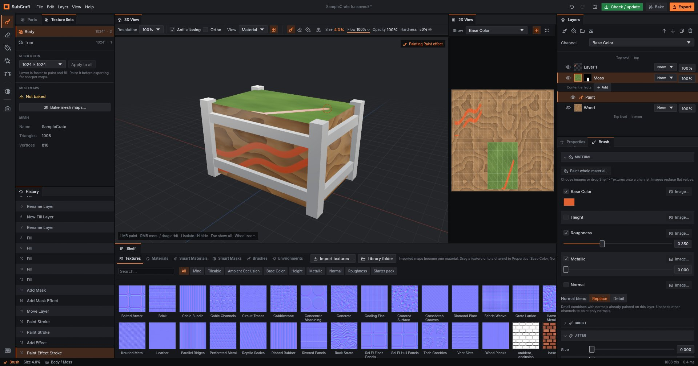

Folders support Filter/Levels adjustments on their children or the lower stack in Passthrough
mode. Their effect previews include the correct lower input and exclude later siblings.
Previews update in the background after painting or parameter changes; very fine marks can
disappear at thumbnail resolution. They are regenerated when you reopen a project.
Compare Mask, anchors and further filter operations remain planned; see
**layer-system-roadmap.md**. Current projects use format 12; older projects still open.

Click the **grid icon** beside the material/view controls to show or hide the subtle 3D floor
and direction guides. **Right-click** that icon for axis settings: **X is red**, **Y is green
and points up**, **Z is blue**. Y starts hidden. These display preferences are saved between runs.
The floor sits just below the model, follows world-axis directions, fades into the distance,
and stays behind the model. It does not affect painting, picking or exported textures.

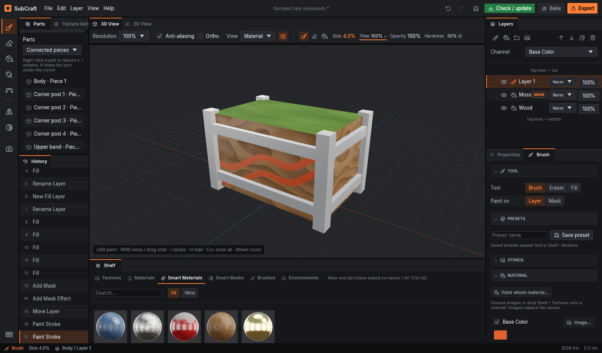

Click the **mirror icon** beside Brush/Eraser/Fill in the 3D toolbar for **Symmetry & Lazy Mouse**.
Toggle **X**, **Y** and **Z** independently; combinations mirror across several planes through
the model center. The small **Lazy Mouse** slider controls how far the brush trails the cursor
(0–100px; **0 is off**). The icon turns orange when any mirror or Lazy Mouse is active.
The popover stays open while adjusting; click outside or press Esc to close. Existing **X**
still toggles mirror X. These settings are included in brush presets and add no undo step.
The old sidebar Stroke controls and left-rail symmetry shortcut button have moved here.
Enabled mirror axes show red guides on the model where the actual mirror planes intersect it.
The surrounding red outline identifies each plane beyond the surface. Guides update when you
switch X/Y/Z and disappear when symmetry is off. Disable **Show symmetry guides** inside the
same popup to hide the lines while retaining mirrored painting; the preference is remembered.

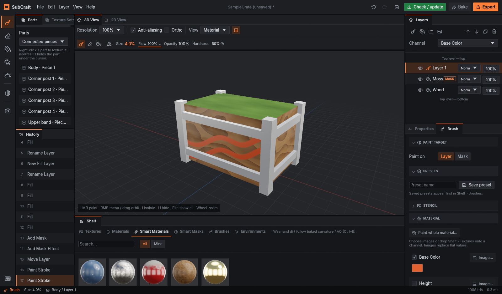

Material actions use calmer gray text and almost-square 2px corners. Each brush channel's
**Image…** action chooses a texture; existing images still offer Replace/Clear. **Paint whole
material…** sits below the Material header with its own spacing.

Select an ordinary **paint layer**, choose **Brush (B)**, and set **Paint on → Layer** in the
Brush panel. In **Material**, use the channel's **Image…** (or **Replace…**) button.
For a normal-only stroke, Alt+click **nrm**. **Clear image** restores that channel's
flat value; its enable checkbox still decides whether it paints. Normal maps use OpenGL (+Y);
files named `normalDX` / `normal_dx` are converted automatically when assigned to Normal.

Use **Paint whole material…** to select several named maps together, such as `Metal_basecolor`,
`Metal_roughness`, `Metal_metallic`, `Metal_normalDX`, `Metal_height`. This loads the brush and
enables only those channels. It creates no layer. Missing texture-set channels are skipped and
reported; packed ORM/ARM imports remain unsupported. Gloss/smoothness maps invert to roughness.
Imported images from **Shelf → Textures** can also be dragged onto a brush channel row. Starter
pack normal drops still target fill layers in this version; use an imported file for a brush.

**Image projection** is independent of brush footprint **Alignment**. UV follows the model UVs;
Planar projects along X/Y/Z; Tri-planar blends the three object-axis projections. Tiling X/Y
(**Link** for equal repeats), Offset, Rotation and Sharpness use the same controls as fills.
Untick **Tile images** to paint only inside the transformed image. Camera/per-stamp image
projection is still planned. Normal map vectors follow the existing fill interpretation;
projection-frame rotation does not yet reorient tangent vectors across mirrored/separate islands.

**Normal blend → Replace** replaces normals under the brush. **Detail** combines the new map
with normals already painted on this same layer. Use the layer's normal blend mode to combine
with lower layers. Both stroke modes normalize their result. Size, flow, opacity, alpha tips,
stencils, symmetry and Parts restrictions continue to apply; the entire drag is one undo step.

**Presets → Save preset** stores the images, projection, tiling and normal blend along with the
existing brush settings. The preset carries its image bytes and works in another document after
the original files are removed. Projects save the painted pixels; load the brush preset to
restore its tool setup. There are no new keyboard shortcuts in this slice.

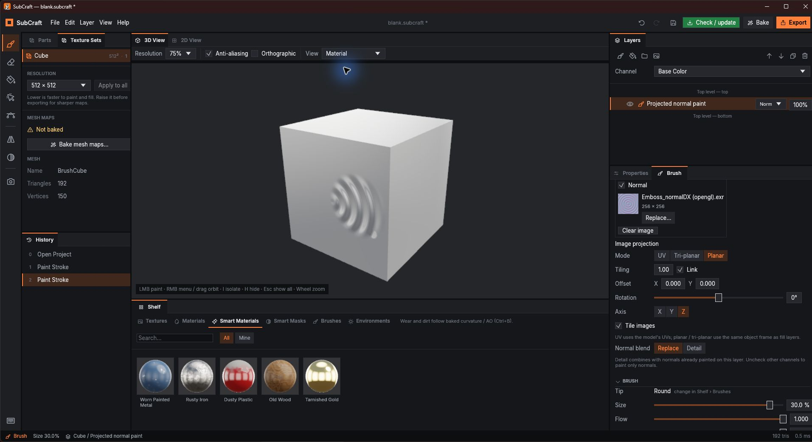

## 5. Save your project

### Example: CORE-07 sci-fi cube

The local [CORE-07 artwork](../artworks/CORE-07/README.md) demonstrates a 4K high-to-low bake,
PBR materials and editable masks. Open `artworks/CORE-07/CORE-07.subcraft` in SubCraft 0.1.7+.
Click the armor/service layer's content square to edit its material, or a mask square to paint
coverage. The top wear and grime layers expose Generator + Levels settings driven by the baked
curvature and AO. Add a Paint layer for freehand additions. The companion asset ZIP includes
low/high OBJ models, raw bakes, standard PBR maps, Unreal maps and renders. On a fresh checkout,
generate these local files using the recipe in the artwork README.

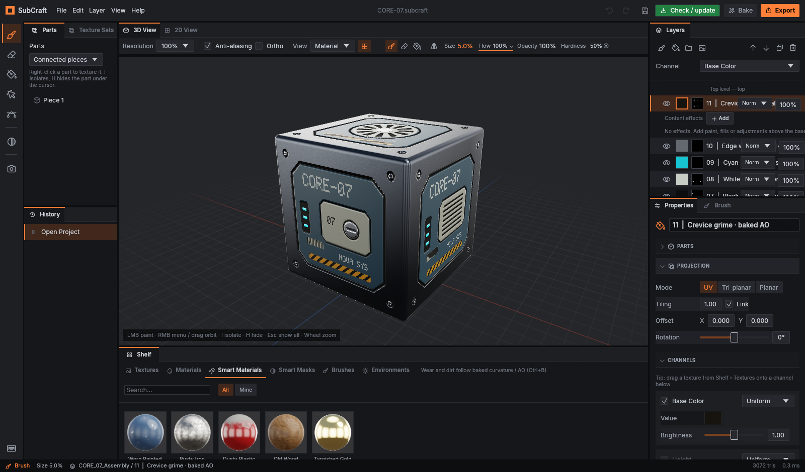

For deeper panel detail and more varied reflections, open the separate
`artworks/CORE-07-Refined/CORE-07.subcraft` project. Ceramic, ivory covers and steel each have
procedural roughness. Toggle layers **12–14** to compare broken edge scuffs, settled dust and
small rust patches on steel. Select their content thumbnails to adjust material values, or
their masks to edit coverage. Layers **10–11** retain curvature/AO Generator + Levels controls.
The original project is preserved. See the [refined artwork guide](../artworks/CORE-07-Refined/README.md)
for the rebuild command and exported map conventions.

On desktop, procedural layers update in the background. During a large 4K edit, the model may
briefly show a mixture of old and new tiles while the interface stays available; the latest
settings win and the full texture catches up after you stop dragging. Export waits for the
complete result. Saving always stores your latest layer, mask and effect settings, including
edits whose viewport preview is still catching up. There is no background-compositing toggle
or new shortcut to learn.

Use **File → Save** (Ctrl+S) to save a `.subcraft` file containing the model, layers, imported
images and baked maps. SubCraft saves to the location you choose.

Autosave creates recovery copies in SubCraft's data folder. It does not overwrite your
project file. Save your own project regularly.

## 6. Export textures

### Choose what to export

Click **Export** (Ctrl+Shift+E). The window lists every output map of the template for each texture
set, with a checkbox per map, a checkbox per set, **Select all / None / Invert** and a live
"N of M files" count. **Alt+click** a map to export only that one; Alt+click it again to restore your
selection. Your choices, the template and the normal-map convention are saved with the project.
Models with UDIM tiles export as `Name_Body_BaseColor.1001.png`, or one folder per tile if you turn on
**Export each UDIM to a separate folder**.

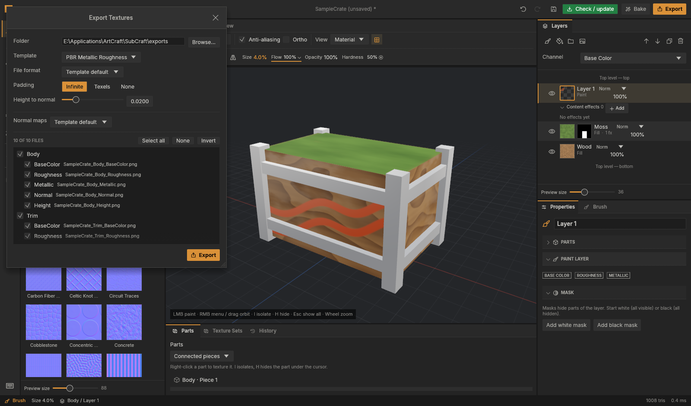

### Pixel art and retro albedo textures

In the **Texture Sets** panel, beneath Resolution, choose **Albedo → Nearest**.
This control is available only there; the 3D toolbar keeps the other viewport controls.
**Bilinear** blends neighboring image texels; **Nearest** keeps their hard boundaries. The
dropdown applies to the selected texture set and stays in sync in both places. In narrow
3D docks, find it under **View**. Ctrl+Z undoes the change.

The choice affects imported Base Color fill images, content fill effects, future textured brush
strokes, Base Color resampling when changing working resolution, the 3D/2D preview and exported
albedo pixels. Other channels keep their usual filtering. It cannot undo blur already painted
into a raster; reapply the source image if needed. Soft brushes, layer blends and triplanar
axis blending still mix colors; use UV or planar projection when an exact palette is required.

Use 100% viewport resolution when inspecting pixel edges. Anti-aliasing remains an independent
geometry-edge setting. Export normally, then also select nearest/point texture sampling in
your game engine: image files contain pixels, not runtime sampler settings.

Projects saved by this build use **schema 6** and remember the choice per set. Older projects
open with Bilinear. Current saves use schema 7 and require this build or a newer reader.

Developers can regenerate comparison projects and exports with the `retro_albedo` app example.

[Compare Bilinear](screenshots/albedo-bilinear-3d.png) ·
[Nearest in 3D](screenshots/albedo-nearest-3d.png) ·
[Nearest in 2D](screenshots/albedo-nearest-2d.png)

### Bake a high-resolution mesh onto your painting model

Open the **low-poly** model with its UVs first, then click **Bake**. In **High poly → Browse…**,
choose the detailed OBJ, FBX, GLB or glTF source. The high-poly source does **not** need UVs.

Before pressing Bake, leave **High / low overlay** enabled: the source loads in the background
and appears over the low-poly model in its exported coordinates. **Blue** is the high-poly
surface; **red** shows exposed low-poly surfaces sticking through it. Orbit with RMB (or
Alt+LMB), pan with MMB and zoom with the wheel to inspect all sides. **Cage wireframe** shows
the front/rear projection limits; changing **Cage front / rear** updates those lines live.
This is a surface comparison, not a complete cage-error heatmap: blue does not guarantee every
detail lies inside the cage. Export both models in matching coordinates; SubCraft does not
automatically align or rescale them.
Re-exporting or replacing the high-poly file automatically refreshes the preview while Bake
is open. Loading runs in the background; the previous mesh remains visible until the replacement
is ready. **Reload high poly** is optional. A running bake keeps the source it started with;
the updated mesh is used for the next bake.

With **Live maps** and **Follow bake** enabled, each finished map appears on the low-poly model
while the next map computes. The progress text names the map currently baking. The map menu
lets you inspect a finished map or choose **Material**; selecting one stops automatic following.
Scalar maps display grayscale. Updates happen one complete map at a time, including UV padding;
there is no animated texel wipe. Supported maps are Normal, World Space Normal, ID, Ambient
Occlusion, Curvature, Position and Thickness; Height baking is not implemented yet.
Switch Live maps off to retain the material view. Every successful bake automatically returns
to **Material**, including the viewport selector. Close the dialog to return to painting.
**Inspect high / low geometry** returns to the overlay after a bake. Cancel retains maps that
already finished and discards the incomplete map. The normal layer may therefore remain after
cancelling a later map. These preview controls do not change your material or export settings.

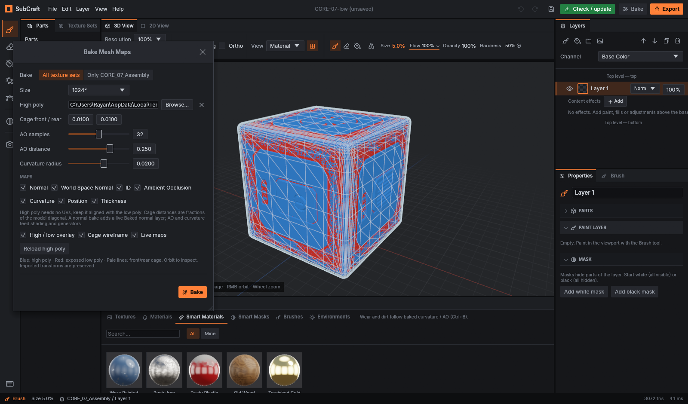

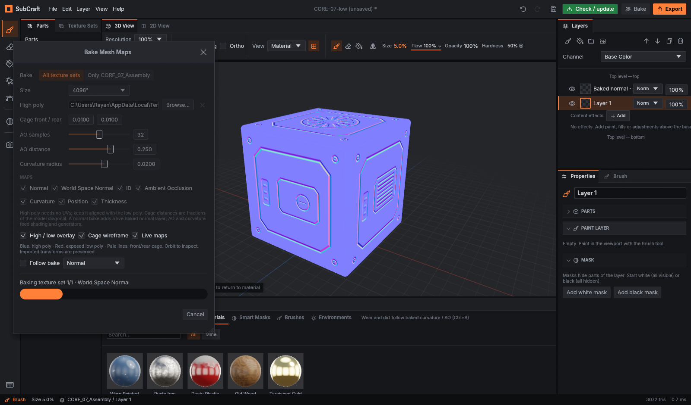
Export both meshes in the same position, orientation and scale. Choose a bake size and maps,
then press **Bake** in the dialog. Loading/BVH/bake progress appears there; the result or error
stays visible until you start another bake.

Keep **Normal** enabled to see high-poly detail. A successful high-poly normal bake adds
**Baked normal · high poly** in Layers, affecting only Normal. Its live mesh-map reference
updates when you bake again; an existing Normal mesh-map layer is reused. You can hide this
layer to compare the result or adjust its Normal opacity/strength. The normal result is included
in saved projects and texture exports. Other channels keep their authored materials.

If the dialog says no high-poly surface was reached, check model alignment and increase
**Cage front / rear** carefully. These distances are fractions of the model's bounding diagonal:
0.01 means 1%. Too small misses details; too large can hit unrelated nearby surfaces.
Inspect individual maps using **2D View**. Baking changes surface shading, not the low-poly
silhouette. For reproducible desktop checks, `subcraft low.obj --bake-high high.obj
--bake-size 1024` opens this workflow; `--screenshot result.png` waits for completion.

Click **Export** (Ctrl+Shift+E). Choose PBR metal/rough, Unreal, Unity HDRP or glTF to match your
target application. Maps are written to the folder you choose.

The Unreal template packs ORM and uses DirectX normals; PBR/glTF use OpenGL normals. Choose the
right template before judging the result under lighting.

## Editable pen paths

Select **Pen (P)**. Click on the model or in **2D View** to add an anchor; drag while adding it
to create Bézier handles. Drag existing anchors/handles to edit, or hold **Shift** to move one
handle separately. **Enter** finishes adding points, **Esc** cancels the current edit and
**Delete** removes the selected point. Each released gesture is undoable; parameters stay
editable after saving and reopening.

In **Properties → Editable pen path**, use **New path**, **Corner/Smooth**, **Closed path**, width,
hardness, opacity and channel values. Width is measured in UV space. Use 2D View for handles
outside UV islands; use separate paths across seams. Overlapping UVs share texture painting.
Middle/Alt drag pans; the wheel zooms. Pen uses round strokes; alpha tips and symmetry remain
brush tools. Save/Export waits for any path still being drawn.

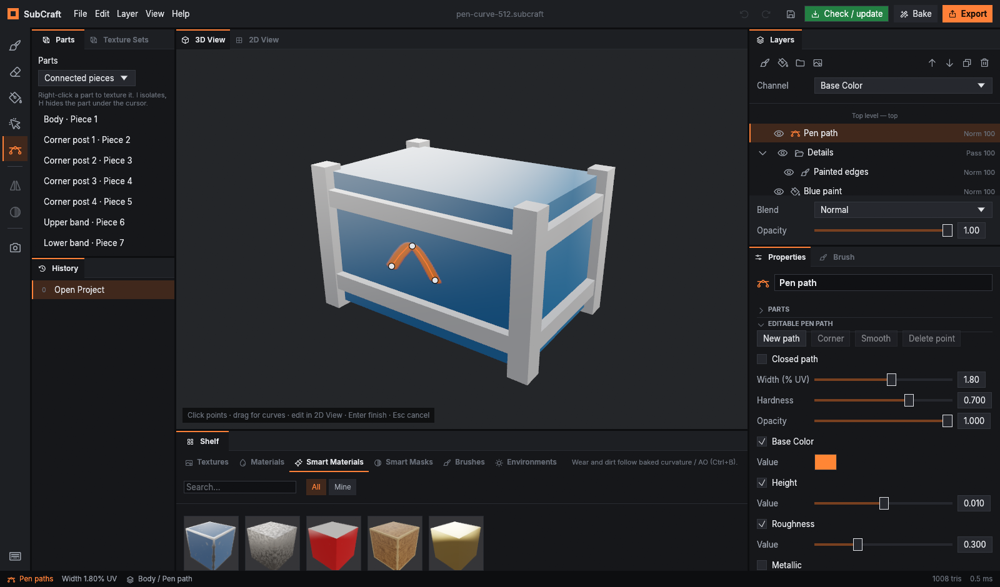

Projects saved with the Pen tool use schema 4 and need SubCraft v0.1.5 or newer to reopen.
Earlier projects still open.

## Starter textures and alpha tips

In **Shelf → Textures → Starter pack**, drag a normal map onto a fill layer's **Normal** row,
or onto the model/layer list to add a normal-only fill layer. **Tileable** filters the tagged
maps. In **Shelf → Brushes → Starter pack**, click an alpha to preview it, then **Use as brush
tip**. Built-in tips and imported images remain available in All/Mine.

Click a texture to open its preview. Choose **1×1 / 2×2 / 3×3** to inspect seams. Normals have a
strength slider, a lit sphere, green flip for OpenGL/DirectX and bump inversion. Alphas have
brightness/contrast, invert and a sample stroke. Both offer scale, rotation, wrap mode and
**Make seamless** edge blending. Inspect the repeated result; blending softens boundary details.
**Add adjusted fill layer** bakes the adjustments into a new image copy. The original files stay
unchanged, and normal-map resources travel inside saved projects. Width/height are 1024px for
all pack images. Full images load only when selected; desktop needs no network connection.

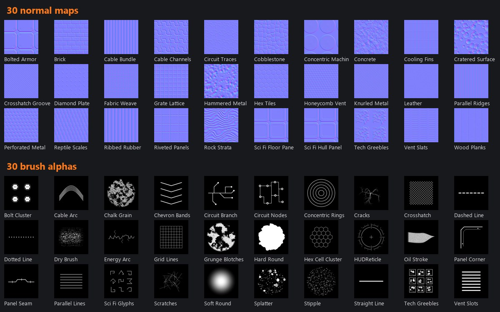

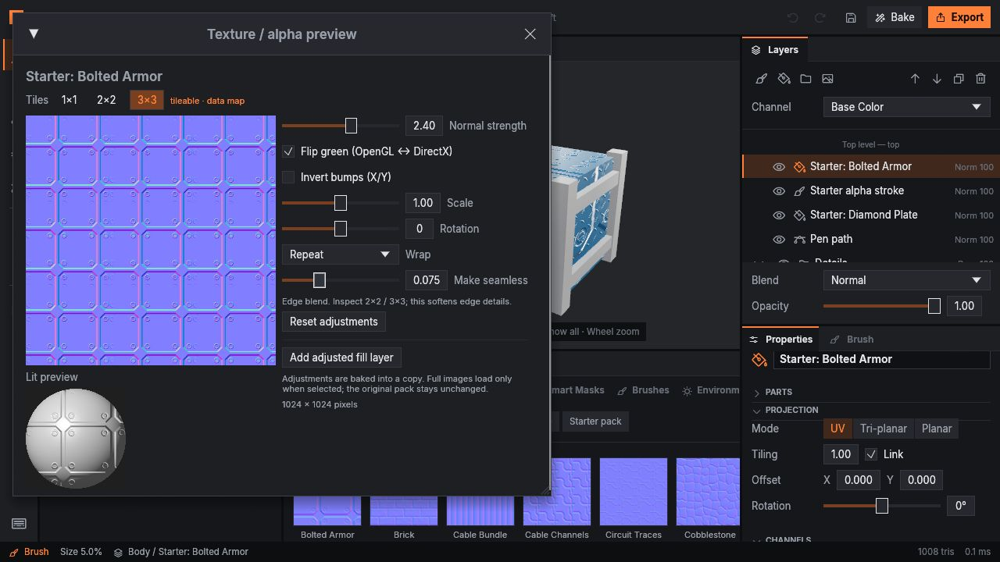

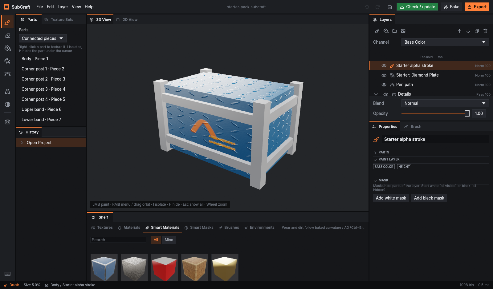

The images are [CC0](../assets/starter-pack/CREDITS-CC0.txt), including for commercial use.

For more detail, see the [README](../README.md), [changelog](../CHANGELOG.md) and
[development notes](development.md).
