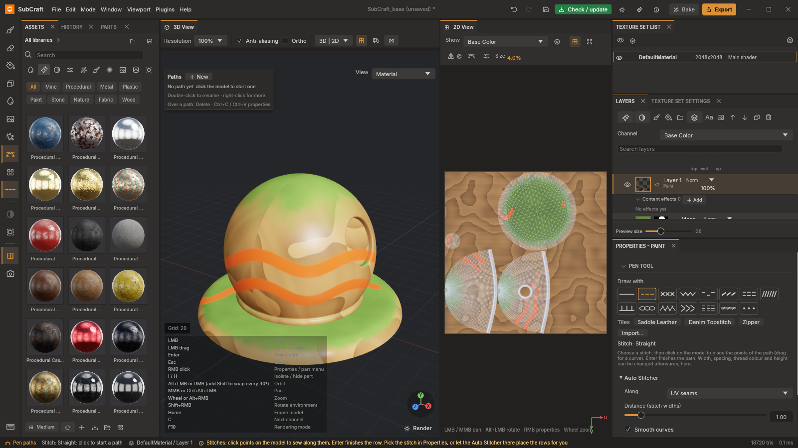
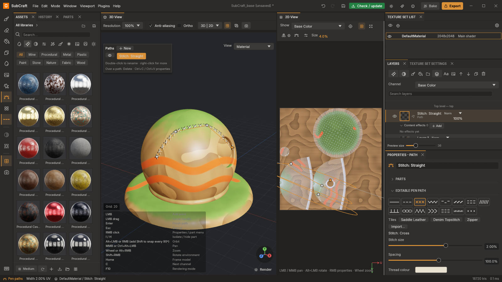
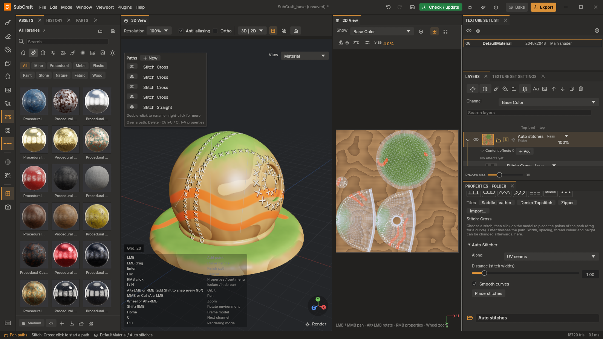
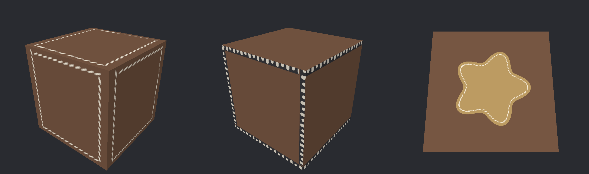

# Stitches

How to put stitched seams on a model. There are two ways: draw the seam yourself with the pen,
or let the Auto Stitcher place the rows along UV seams, open borders or a mask's edge.

## Where the stitch tools are

- **Tool rail (left side)**: the **Stitches** button, three dashes in a row, right under the
  Pen and Shape tools.
- **Edit > Stitches**: the same things by name. *Draw stitches with the pen*, *Auto Stitcher:
  place along UV seams* and a link to this page.
- **Properties panel**: once the Stitches button is on, the stitch list, the stitch tiles and
  the **Auto Stitcher** are here.

## Draw a seam with the pen

1. Click the **Stitches** button. The Pen tool starts with the Straight stitch chosen.
2. In **Properties**, pick a stitch from the row of pictures under **Draw with** (Saddle, Cross,
   Zigzag, Whip, Baseball and more), or a **stitch tile** (Saddle Leather, Denim Topstitch,
   Zipper, or your own images with **Import...**).
3. Click on the model to place the points of the seam. Drag while clicking for a curve.
4. Press **Enter** to finish the row. Click again to start the next one.

The seam lies on the model, not in the UV layout, so it can run over UV seams: put one point on
each side and the stitches continue over the edge.

### Change a row afterwards

Each row is its own layer, a pen path. Select the layer and, with the Pen tool, Properties shows:

- **Stitch size**, **Spacing**, **Thread colour** and **Raised** (how far the thread stands out).
- Another stitch: click a different picture and the row is redrawn with it.
- **Add needle holes** and **Add seam groove**: a second path on the same points that presses
  holes or a soft line into the surface, so the thread sits in the material.
- Move points by dragging them. **Corner** and **Smooth** change the selected point.

If the texture set has no Height channel, a note offers to add one. Without it the stitches are
flat colour.

## Auto Stitcher: rows without drawing

1. Click the **Stitches** button and pick the stitch or tile you want.
2. In **Properties**, open **Auto Stitcher**.
3. **Along** says where the rows go:
   - **UV seams**: where two UV islands meet on the model. Clothes and bags are usually unwrapped
     along their real seams, so this is often the whole job.
   - **Open borders**: the free edges of the mesh, like a hem or the rim of a pocket.
   - **UV seams and open borders**: both.
   - **Edge of the selected layer's mask**: the outline of a mask, for a patch or a label.
     Select the layer that has the mask first.
4. **Distance** is how far from the edge the row runs, in stitch widths. At 0 a UV seam gets one
   row right on it (a zipper, a cross stitch). Above 0 it gets one row on each side, like a
   topstitched seam.
5. **Smooth curves** rounds the rows where they bend gently. Sharp corners stay corners.
6. Click **Place stitches**.

The rows arrive as normal pen path layers in a folder named "Auto stitches", as one undo step.
Edit, restyle or delete any of them like a row you drew yourself. The stitches come out the same
size on every UV island, also when the islands have different texel density.

### Limits

- At most 64 rows per run, the longest first. The status line says when some were left out.
- The rows are not linked to the mesh or the mask. If those change, delete the folder and run
  the Auto Stitcher again.
- A mask edge that runs exactly along the border of a UV island is skipped.

## Your own stitch tiles

A stitch tile is one repeat of a seam as images: colour with transparency, a height map and a
normal map. **Import...** takes any one of the files and finds the others beside it by name, for
example `seam_color.png`, `seam_height.png` and `seam_normal.png`. The seam runs from left to
right in the image, and the right edge continues into the left. More detail is in
[Getting started](getting-started.md), section "Stitch tiles".
